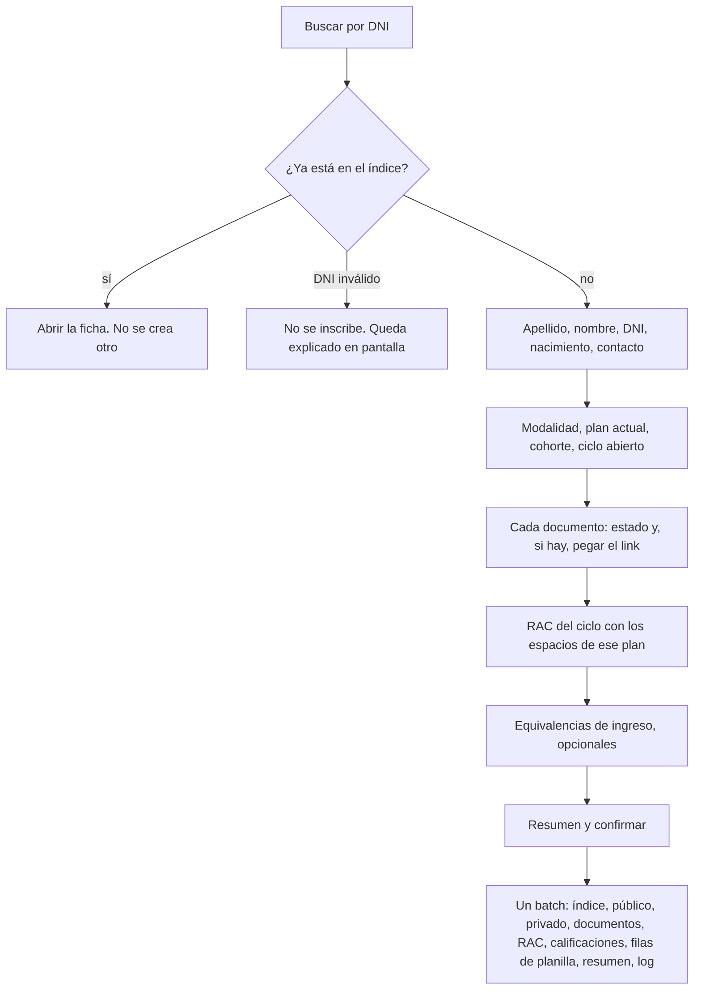

# Plan de rediseño — CEIJA N° 12, sede Las Higueras

Documento de planificación. No implementa pantallas, no cambia reglas y no se despliega.
No toca el proyecto Firebase real (`ceija12resm`). No hay datos personales: los ejemplos son esquemas, no personas.

Fecha del relevamiento de Drive que usa este plan: 22/10/2026. La app vive en https://ceija12resm.web.app y el registro oficial sigue siendo el Libro Matriz en papel y el SGE. Esta herramienta es de trabajo interno de la sede.

## 1. Qué hay que lograr

1. Inscribir estudiantes sin duplicar DNI y sin mezclar el padrón con el legajo privado.
2. Guardar la documentación **solo como links** (Drive o el título digital). La app no almacena archivos. El plan Spark no tiene Storage y no hace falta pasarse a Blaze para esto.
3. Administrar el RAC: trayectoria del estudiante, ciclo abierto, cierre y pase al ciclo siguiente.
4. Cargar notas rápido: grilla con teclado, autoguardado, usable en el celular.
5. Una interfaz clara para secretaría y para docentes, de día y en el horario de cursado (martes y miércoles, 20 a 23).

## 2. Diagnóstico

Conviven tres descripciones de la escuela y no dicen lo mismo.

### 2.1. Lo que ya está en el código (modelo nuevo)

El tablero actual (`DashboardLayout`) usa este modelo. Las reglas están en `firestore.rules` y hay pruebas de dominio y de reglas contra el emulador `demo-ceija`.

| Pieza | Estado |
|---|---|
| Roles `admin`, `docente`, `lectura`, `pendiente` (y los viejos `Administrador` / `Profesor`) | Hecho. Nadie se cambia el rol solo. |
| `estudiantes` público + `privado/datos` + `dniIndex` | Hecho. El alta es un solo batch (`crearEstudianteConRac`). |
| `rac/{estudiante}_{año}_{plan}/calificaciones/{espacio}` | Hecho. Cerrar marca `adeuda` y deja la nota de solo lectura. |
| `indices`, `resumenes`, `equivalencias`, `pases`, `logs` | Hechos. El pase provisorio vence a los 60 días. |
| Planilla docente | Existe, pero es lenta de usar: un `<select>` de notas, fecha `mm/aa`, y un botón Guardar por fila. Cada fila pide la nota en una lectura aparte. |
| Documentación | Checkboxes en el legajo privado (pase, DNI, CUS, primaria) más un solo `linkLegajoDrive` y `linkTitulo`. No hay un link por documento. |
| `linkLegajoDrive` está en el documento **público** | Lectura puede ver el link a la carpeta. Si ahí hay escaneos del DNI, sobra. Hay que moverlo al privado. |

Los planes sembrados en `src/domain/planesSede.ts` no coinciden con la página pública ni con el RAC:

- Plan A: seis espacios (Matemática, Lengua, Naturales, Sociales, Inglés, M8), con los módulos numerados M1–M5 de forma arbitraria.
- Plan B y Plan C: otra lista corta (Economía, Derecho, Ciudadanía, Proyecto, Vinculación, Formación profesional), también con un solo M8 compartido.
- La página pública (`src/content/sedePublica.ts`) dice otra cosa: A es 1° (módulos 1, 2, 3 y 8), B es 2° (4, 5 y 8), C es 3° (6, 7, 8 y 9), y en los tres años nombra los mismos cinco rótulos (Matemática, Interpretación y Producción de Textos, Ciencias Naturales, Ciencias Sociales, Área Técnico Profesional). No nombra Inglés.

### 2.2. Lo viejo, que la pantalla ya no usa

Siguen en el repo, desconectados del tablero: `StudentManagement`, `GradesManagement`, `StudyPlanManagement`, `SubjectManagement`, `BulkImportModal`, y las colecciones `students`, `grades`, `subjects`, `studyPlans`, `equivalences`.

`students` junta DNI, contacto y documentación en el mismo documento. Las reglas lo dejan solo para admin. El padrón real de la sede **no está cargado** en el modelo nuevo. El esqueleto `scripts/migracion/migrar.mjs` cuenta un CSV en el emulador y se niega a escribir; si el project id no empieza con `demo-` o si aparece `ceija12resm`, corta.

No hay que revivir esas pantallas. Se borran en la última fase, cuando el padrón nuevo esté verificado.

### 2.3. Lo que muestran las planillas (relevamiento de Drive)

Sin copiar filas de personas:

- **LEGAJOS**: padrón maestro, del orden de 500 filas y 19 columnas con encabezado. Documentación por columna (`SI` / `ADEUDA` / texto), no por link. El único link habitual es el del título (sisfet). La celda vacía no se distingue de "nadie la miró". No hay columna de baja. `ESTADO` solo aparece como título emitido. `CURSADO` es semipresencial o virtual. `PLAN INICIAL` y `PLAN ACTUAL` son textos del estilo `A2026`, `B2022`, a veces la letra sola, a veces dos planes, a veces texto libre.
- **RAC 2026**: una pestaña por Plan A, Plan B, Plan C y VIRTUALES. No es una tabla: es una matriz de bloques por estudiante. En los rótulos, las cuatro pestañas repiten **42 espacios** con código `módulo.orden`:
  - Módulos 1 a 7: `n.1` Lengua, `n.2` Inglés, `n.3` Matemática, `n.4` Cs. Naturales, `n.5` Cs. Sociales (35 espacios).
  - Módulo 8: `8.1` a `8.5` (Ciudadanía, Formación para el trabajo, Derecho del Trabajo, Economía, Formación Profesional).
  - Módulo 9: `9.1` Espacio de orientación, `9.2` Espacio de vinculación.
  - Al final, una sección EQUIVALENCIA de cuatro renglones libres.
- La cantidad de bloques no coincide con la nómina. La fila 2 tiene `#REF!`. VIRTUALES no tiene DNI. Hay más de 15 formatos de fecha, notas en texto (`apro`, `aus`, `10 (diez)`), decimales (6.5, 9.5) y la cadena `PLAN B` / `PLAN C` usada **como nota**, para decir que el espacio ya está acreditado en otro plan.
- Hay un archivo RAC por año, de 2020 a 2026. El de 2026 mezcla fechas viejas: es una trayectoria acumulada, no la lista de lo que se cursa este año.
- **EQUIVALENCIAS HISTORICAS**: fecha, espacio en texto libre, estudiante, DNI, nota, estado (`VERIFICADA` / `FALTA ASENTAR`). El nombre del espacio no usa el código `n.m`.
- Formularios de solicitudes y de inscripción a exámenes: quedan en Forms. Este plan no los reemplaza.
- Problemas de calidad que la importación tiene que dejar en una cola, no adivinar: DNI duplicados, DNI vacíos, DNI no numéricos, edad calculada mal (no se importa la edad), códigos de plan ilegibles, cruce de VIRTUALES solo por nombre.

### 2.4. La contradicción que traba el modelo

Hay tres hipótesis sobre A, B y C:

| Fuente | Qué dice |
|---|---|
| RAC 2026 | Las cuatro pestañas imprimen los mismos 42 rótulos. Puede ser la trayectoria completa, o puede ser una plantilla copiada. |
| Página pública y resoluciones citadas ahí | A, B y C son 1°, 2° y 3° de Economía y Administración. Cada año cursa un tramo de módulos, y el M8 se arrastra. |
| `planesSede.ts` | También trata A/B/C como años, pero con otra lista de espacios y otros números de módulo. |

Este plan **no elige la currícula**. Elige una forma de guardarla para que la respuesta de Nahuel sea un dato, no una reescritura.

Hipótesis de trabajo, marcada como tal hasta que Nahuel responda: los 42 códigos son el catálogo; cada plan es un subconjunto; `B2026` es "plan B, cohorte 2026"; VIRTUALES es la modalidad virtual, no un cuarto plan; la celda `PLAN B` en una nota significa "acreditado en el otro plan". Si la respuesta dice lo contrario, se cambia el subconjunto del plan y no la clave de las notas.

## 3. Decisiones recomendadas

1. Evolucionar el modelo nuevo. No crear colecciones paralelas `alumnos` / `calificaciones` sueltas: se perderían el legajo privado, el `dniIndex` y las reglas ya probadas.
2. Separar tres cosas que hoy están mezcladas en la palabra "RAC":
   - **Catálogo**: los 42 códigos, estables.
   - **Ciclo**: lo que este estudiante cursa este año, en un plan, y lo que el docente edita.
   - **Acreditación**: la nota que ya quedó (el casillero de la matriz histórica). Una por estudiante y código.
3. La planilla del docente lee y escribe filas chicas, una por estudiante. No un arreglo gigante y no una lectura por nota.
4. Los archivos no entran a Firebase. Solo URLs de una lista blanca, en el legajo privado.
5. Seguir en Spark. Blaze no se justifica con el uso de la sede (sección 8).
6. Sistema de componentes en el repo (sección 7). No un skill genérico de "hacerlo lindo".
7. La importación real la corre Nahuel, en su computadora, cuando las fases anteriores estén aceptadas. Un agente no despliega ni escribe en `ceija12resm`.
8. Libro Matriz y SGE siguen siendo la fuente oficial. La app no emite títulos ni reemplaza Gestión Estudiantes: solo registra el estado de carga (`GESTION E`) como dato de secretaría.

## 4. Modelo de datos

Identificadores opacos (`estudiantes/{id}` autogenerado). El DNI no es el id del estudiante: va solo al índice y al privado. Así un DNI mal cargado se corrige sin mudarlo de documento.

### 4.1. Catálogo

`catalogoEspacios/{codigo}` con código `1.1` … `9.2` (punto, tal como está en el RAC):

| Campo | Ejemplo de forma |
|---|---|
| `codigo` | `1.3` |
| `nombre` | Matemática |
| `modulo` | `1` a `9` |
| `orden` | entero para ordenar dentro del módulo |
| `area` | Lengua, Inglés, Matemática, Cs. Naturales, Cs. Sociales, ATP, Orientación |
| `tipo` | `EC` o `ATP` |
| `version` | entero. La versión 1 es la de los rótulos del RAC 2026, todavía sin validar contra la resolución |

`planes/{planId}`:

| Campo | Uso |
|---|---|
| `codigo` | `A`, `B`, `C`, u otro que secretaría cree (Arte y Cultura y Deportes no se inventan) |
| `nombre`, `ciclo` (`CB`/`CO`), `orientacion`, resoluciones, `version`, `activo` | Como ahora |
| `espaciosIds` | lista ordenada de códigos del catálogo. **Vacía o marcada `borrador` hasta la respuesta de Nahuel.** No sembrar los seis espacios actuales como si fueran la verdad |
| `compartidos` | códigos que se replican entre planes (hoy el M8). Sigue siendo explícito, no mágico |

El M8 compartido se mantiene: si el docente marca la nota en un plan y la regla lo autoriza, el cliente copia el parche a los otros RAC abiertos del mismo estudiante que tengan ese código. La regla ya lo acota; no se afloja.

### 4.2. Estudiante

`estudiantes/{id}` — lo pueden leer admin y lectura. Sin DNI completo, sin contacto, sin URLs.

| Campo | Notas |
|---|---|
| `apellido`, `nombre` | Texto limpio (sin tabs, espacios simples). No se guarda la edad. |
| `dniEnmascarado` | Como ahora (`**.***.482` es la forma, no un dato real). |
| `estado` | `activo`, `baja`, `egresado`, `pase`. El motivo de la baja queda abierto (pregunta 3). |
| `modalidad` | `semipresencial` o `virtual`. Reemplaza la pestaña VIRTUALES. |
| `planActualId` | Plan en el que está hoy. |
| `cohorteAnio` | El año de `B2026`, no la letra. |
| `gestionSge` | `cargado`, `no_cargado`, `pase_solicitado`, `pase_invalido`. Es el estado en Gestión Estudiantes, no el estado académico. |
| `documentacionResumen` | `completa`, `incompleta`, `sin_revisar`. Sin links. Para que lectura vea el semáforo. |
| `sede` | Las Higueras. |
| `condicionIngreso` | `Reg`, `Prev`, `Equiv`, `Lib`. |
| `creadoPor`, `fechaCreacion` | Igual que ahora. |

Sale de acá `linkLegajoDrive`. La carpeta del legajo puede tener escaneos.

`estudiantes/{id}/privado/datos` — solo admin:

`dni`, `dniNormalizado`, `cuil`, `email`, `telefono`, `fechaNacimiento` (ISO `aaaa-mm-dd` o vacío), `observaciones`, `linkCarpetaDrive` (opcional, misma lista blanca).

No se guarda `edad`. Doce edades en 126 en la planilla son una fórmula sobre una fecha vacía: se calcula en pantalla si hace falta y hay fecha.

`dniIndex/{dni}` — solo dígitos, 7 u 8. Crear si no existe. No se actualiza. Corregir un DNI es una operación de admin: crear la clave nueva y borrar la vieja, las dos en reglas, con log que guarda el DNI enmascarado y no el completo. Hoy la regla prohíbe update y delete: hay que abrir solo el delete de admin para este caso, no un update libre.

Quien no tiene DNI válido (vacío, "sin DNI", número con texto) **no entra** al índice ni a la planilla. Queda en `revisiones/{id}` (sección 6) hasta que secretaría lo resuelva.

### 4.3. Documentos, solo links

`estudiantes/{id}/documentos/{tipo}` — solo admin lee y escribe.

Tipos cerrados: `fotocopia_dni`, `certificado_primaria`, `cus`, `pase_provisorio`, `pase_definitivo`, `titulo`, `otro`.

| Campo | Valores |
|---|---|
| `estado` | `presentado`, `adeuda`, `no_corresponde`, `en_proceso`, `sin_revisar` |
| `url` | Vacía, o `https` de un host permitido |
| `detalle` | Texto corto. En primaria: original, constancia, etc. En el pase definitivo: "digital en Drive" cuando la planilla decía eso y no había URL |
| `actualizadoEn`, `actualizadoPor` | ISO y uid |

Hosts permitidos, y ningún otro:

- `drive.google.com`
- `docs.google.com`
- `sisfet-firma.educacion.gob.ar` (título digital)

La regla rechaza otro host, rechaza `http`, y rechaza cualquier string que parezca una ruta de Storage. Celda vacía de la planilla → `sin_revisar`, no `adeuda`. `ADEUDA` → `adeuda` con URL vacía. `SI` sin URL → `presentado` con `detalle` que avisa que falta el link. No se inventa un archivo.

El semáforo público se recalcula en el mismo batch: si falta algún tipo obligatorio en `presentado` o `no_corresponde`, el resumen queda `incompleta`. Qué tipos son obligatorios es pregunta para Nahuel; hasta entonces el semáforo mira DNI, primaria, CUS y pase, y el título solo cuando el estado es `egresado`.

La equivalencia no es un documento escaneado. Es un acto (sección 4.6). El número `nnn/aaaa` vive ahí.

### 4.4. Ciclo y RAC editable

`ciclos/{anio}`: `abierto` o `cerrado`, como ahora.

`rac/{estudianteId}_{anio}_{planId}`: un RAC por estudiante, año y plan. Campos actuales (`estado`, apellido, nombre, `resumen`) más `modalidad`.

`rac/{racId}/calificaciones/{codigo}`: **solo los códigos que el plan incluye para ese ciclo**, no las 42 filas vacías.

| Campo | Notas |
|---|---|
| `espacioId` | El código `1.3`, igual al id del documento |
| `nombre`, `modulo`, `orden` | Copiados del catálogo al crear, para imprimir aunque el catálogo cambie de versión |
| `notaFinal` | `null` o número de 1 a 10 de a medio punto |
| `notaLetras` | Derivada, como ahora |
| `fecha` | ISO `aaaa-mm-dd`, o vacía. Se deja de usar `mm/aa` como único formato: el RAC histórico tiene día, y el Libro también. En la impresión se puede mostrar `dd/mm/aa` |
| `condicion` | `Reg`, `Prev`, `Equiv`, `Lib`, `Aus`, `OtroPlan` |
| `planAcreditadoId` | Solo si `condicion` es `OtroPlan` (la celda decía `PLAN B`) |
| `tpi` | Se mantiene el campo por compatibilidad, oculto en la grilla rápida. Ver pregunta 5: hoy una nota ≥ 6 no queda `aprobado` si el TPI no es `APROBADO`. Eso hay que invertirlo si secretaría confirma que manda la nota |
| `estado` | `pendiente`, `aprobado`, `adeuda` |
| `docenteUid`, `actaNro`, `compartidoM8`, `m8RacIds` | Como ahora |
| `actualizadoEn` | Para el autoguardado y para ver quién pisó a quién |

Nota de aprobación de trabajo: **6**, que es lo que ya dicen el código y la página pública. Sigue abierto contra la Res. 001/2020 (pregunta 4).

`Aus` no lleva número. `OtroPlan` no se edita en la planilla del docente: lo carga admin o la importación. `Equiv` la escribe el flujo de equivalencias, no el teclado de notas.

Al aprobar, el mismo batch del cliente copia la acreditación (4.5). Las reglas no confían en el cliente: la acreditación solo entra si un `get` de la calificación muestra la misma nota, el mismo docente y el RAC abierto (sección 9).

### 4.5. Acreditación (la matriz histórica)

`acreditaciones/{estudianteId}_{codigo}` — una por persona y espacio.

`notaFinal`, `fecha`, `condicion`, `planId` donde se cursó, `anio`, `racId` de origen, `docenteUid`, `equivalenciaId` si aplica, `estado`.

Si el mismo código aparece dos veces (RAC 2024 y RAC 2026), gana la acreditación ya guardada y la otra va a la cola de revisión. No se pisa en silencio. El RAC 2026 se importa primero justamente porque ya es la acumulación.

La pantalla de trayectoria arma las 42 filas en memoria: catálogo + acreditación + fila del ciclo abierto. Lo que no tiene documento se muestra como "no cursado" o como "pendiente" según el código esté o no en el plan actual. No hace falta un documento vacío por casillero (500 × 42 escrituras al pedo, y un cierre de ciclo que se come el cupo diario de Spark).

### 4.6. Equivalencias y pases

`equivalencias/{id}` se mantiene, con estos ajustes:

- `espacioId` pasa a ser el código `n.m`, no un texto libre.
- `numero` con forma `nnn/aaaa` (el de LEGAJOS y el de la planilla histórica).
- `estado`: `verificada` o `falta_asentar`.
- `nota` ≥ 6 y de a medio punto, como ya exige la regla.
- Al asentar, se marca la calificación del RAC abierto como `Equiv` / `aprobado` y se escribe la acreditación.

Los nombres históricos ("MATEMATICA PLAN A", "AREA TECNICO PROFESIONAL 2") no se adivinan. Una tabla de alias, sin personas, propone el código; lo que no matchea queda en la cola.

`pases/{id}` se mantiene: ingreso o egreso, provisorio, definitivo, vencimiento a 60 días, alerta a 15 días (`src/domain/alertas.ts`). Sigue siendo cálculo en el cliente, sin función programada. El formulario de solicitudes de Drive no se lee por API: secretaría carga el pase a mano, como ahora.

### 4.7. Planilla del docente (índice que sí se puede editar)

Hoy `indices/{año}_{plan}_{espacio}` guarda un arreglo `filas` y después la pantalla pide cada nota. Dos problemas: una lectura en cascada por estudiante, y `arrayUnion` no actualiza una fila (un cambio de apellido duplica el elemento).

Reemplazar el arreglo por subdocumentos:

`indices/{anio}_{planId}_{codigo}/filas/{estudianteId}`

Cada fila trae, para que la regla no tenga que hacer `get` del padre en un listado: `planId`, `espacioId`, `anio`, `racId`, `estudianteId`, `apellido`, `nombre`, `dniEnmascarado`, `notaFinal`, `fecha`, `condicion`, `estado`, `tpi`, `racAbierto`.

Abrir la planilla es **una consulta** filtrada por plan, espacio y año (las reglas de listado solo pueden mirar `resource.data`, no otro documento). Guardar es un batch de dos documentos: la calificación (fuente) y esta fila (copia para la grilla). Si la copia falla, la fuente quedó bien y la próxima apertura puede reconstruir; se muestra el error igual.

Tamaño: una comisión es del orden de 20 a 50 filas. Entra holgado en Spark. El resumen anual (`resumenes/estudiantes_{anio}`, un documento con el padrón) también entra: 500 ítems compactos están muy por debajo de 1 MB. Si algún día se acerca, se parte por inicial. No ahora.

### 4.8. Revisión de importación y logs

`revisiones/{id}` — solo admin. No es el padrón: es la cola de lo que no se pudo cargar solo (DNI duplicado, fecha ilegible, nota en texto, VIRTUALES sin DNI unívoco, dos notas para el mismo código). Guarda el motivo, el archivo de origen (`legajos`, `rac-2026`, `equivalencias`), la referencia de fila o bloque, y el DNI enmascarado si había uno válido. No guarda el DNI completo ni el teléfono en un campo que lectura pueda ver. El detalle fino queda en el CSV local de Nahuel, que no se commitea (los `.xlsx` y `.csv` ya están en el gitignore).

`logs/{id}`: crear, nunca editar. `uid` = usuario autenticado. El diff no lleva DNI completo, CUIL, teléfono, mail ni URL de documentos.

### 4.9. Qué no se modela en la primera entrega

- Asistencia. No está en ninguna planilla. Pregunta 2.
- Inscripción a exámenes (el Form sigue).
- Horarios de tutoría.
- Archivos adjuntos.
- Edad persistida.
- Una colección `rac` "vista generada" que reemplace a los documentos. La trayectoria se arma al leer; el ciclo y la acreditación son los datos.

## 5. Roles y permisos

Se mantienen los cuatro roles. Los valores viejos siguen andando hasta que se regrabe cada usuario.

| Acción | admin | docente | lectura | pendiente |
|---|---|---|---|---|
| Ver padrón (sin DNI completo ni links) | sí | no | sí | no |
| Ver y editar privado y documentos | sí | no | no | no |
| Ver semáforo de documentación | sí | no | sí | no |
| Ver RAC y trayectoria | sí | solo si tiene el plan y el año asignados, y en la trayectoria solo sus espacios | sí, sin links | no |
| Cargar notas del ciclo abierto, en sus espacios | sí | sí | no | no |
| Cerrar o reabrir RAC, cerrar ciclo | sí | no | no | no |
| Equivalencias y pases | escribe | no | lee | no |
| Asignar roles y espacios | sí, y no el propio rol | no | no | no |
| Exportar con columnas sensibles | sí, con confirmación | no | no | no |
| Logs | lee | no | no | no |

El docente no necesita el padrón: entra a "Mis planillas". Eso ya está bien encaminado y no se abre.

Asignación, como ahora, en `docentes/{uid}`: claves `planId|codigo|anio`, más `ensenaM8` para el espacio compartido. Releer al docente en Usuarios después de cambiar el catálogo, porque las claves viejas apuntan a ids como `matematica` y no a `1.3`.

Nadie se autodesigna rol, `disabled` ni `activo`. El autoregistro sigue creando `pendiente`.

## 6. Pantallas y flujos

Hay que sumar un router (hoy el tablero es un `useState`). Hace falta para la ficha, el botón atrás y para que secretaría comparta "el RAC de este ciclo" sin explicar en qué menú está. Una dependencia de cliente, sin costo en Firebase.

Inicio según el rol, no un menú de once ítems iguales:

- **Admin:** pendientes del día (pases que vencen en 15 días, documentación incompleta, cola de revisión, equivalencias `falta_asentar`) y acceso al padrón.
- **Docente:** la última planilla, y el selector de espacio si tiene más de uno.
- **Lectura:** padrón.
- **Pendiente:** la pantalla que ya existe, sin datos.

### 6.1. Inscripción

Criterios del flujo:

- Primero el DNI, después el resto. El duplicado se detecta antes de tipear la ficha.
- Apellido y nombre van separados. Se muestran como "Apellido, Nombre".
- El ciclo tiene que estar abierto, como ahora.
- Si el plan sigue en borrador (sin espacios confirmados), se puede guardar la ficha y los documentos, y el RAC espera. Mejor eso que sembrar espacios falsos.
- La operación sigue siendo atómica. Con los espacios de un solo plan (no los 42) el batch queda muy por debajo de las 500 operaciones.
- Lectura no ve este formulario.

### 6.2. Ficha

Pestañas: Identidad, Documentos, Trayectoria, Pases, Equivalencias.

Documentos: una fila por tipo, estado visible, campo para pegar el link, error inmediato si el host no está permitido. No hay botón de subir archivo. Admin ve el link; lectura ve el semáforo en el padrón y no entra a esta pestaña.

Identidad privada (DNI, CUIL, teléfono, mail, nacimiento) solo en la pestaña de admin, no en un renglón suelto como el "ver privado" actual.

### 6.3. RAC

Dos vistas del mismo estudiante:

1. **Este ciclo:** espacios del plan, editables si el RAC está abierto y el rol alcanza. Cerrar (admin) pasa lo no aprobado a `adeuda` y bloquea. Reabrir exige un motivo que va al log. Generar el ciclo siguiente abre el RAC del plan destino y arrastra lo no aprobado como `Prev`, igual que la idea actual, pero matcheando por código `n.m` y no por nombre suelto.
2. **Trayectoria:** los 42 códigos agrupados por módulo. Nota, fecha, condición, plan donde se acreditó. Sirve para imprimir un respaldo de papel. El Libro Matriz no se reemplaza: el pie de la impresión lo dice.

El cierre masivo del ciclo se hace **por plan**, no de toda la sede en un clic. Con espacios de más y todo el padrón junto, las escrituras de un solo día pueden pasar el cupo gratuito (sección 8).

### 6.4. Planilla del docente

Una sola tarea: cargar la nota de este espacio.

- Al abrir, el foco cae en la primera nota vacía.
- `1`–`9` carga ese número y baja a la fila siguiente. `0` carga 10.
- `.` o `,` justo después del número lo pasa a medio punto (`6` y después `.` → 6.5).
- `A` marca ausente, sin número.
- `Supr` limpia una nota que todavía está pendiente.
- Flecha abajo o Enter: siguiente. Flecha arriba: anterior.
- Se guarda solo al dejar la fila, o a los 400 ms del último cambio si el docente se queda en la celda. No hay botón Guardar por fila.
- Cada fila muestra el estado: sin cambios, guardando, guardado, error. El error reintenta y no pierde lo tipeado.
- Filtro "solo pendientes". Orden alfabético fijo.
- `Equiv` y `OtroPlan` se ven y no se editan.
- RAC cerrado: la grilla no acepta teclas de nota.
- En pantallas de menos de 720 px no va la tabla ancha: una tarjeta por estudiante, teclado numérico fijo abajo, anterior y siguiente. El docente está en el aula, a veces con el teléfono.
- DNI enmascarado. Sin links. Sin TPI en la primera línea (si se confirma que sigue, va en un detalle, no en el camino de la tecla).

Admin puede abrir la misma planilla para un espacio, para corregir. Lectura no escribe.

### 6.5. El resto, sin rediseñarlo de cero

- **Equivalencias:** elegir estudiante, código, nota, fecha, número, origen. Aviso si la fecha pasa del 1 de julio del ciclo (la regla de plazo ya está en `alertas.ts`). Asentar escribe RAC + acreditación.
- **Pases:** el alta actual, más el semáforo de vencimiento en el inicio del admin.
- **Usuarios:** igual, con las claves nuevas de espacio.
- **Planes:** editor del subconjunto de códigos. Mientras Nahuel no confirme, el plan se ve como borrador y no se puede usar para abrir un RAC.
- **Exportar:** se mantiene el Excel con confirmación para columnas sensibles, y se agregan los links de documentos solo en esa exportación de admin.
- **Público:** la landing queda. Cuando la currícula esté confirmada, se corrige el texto de A/B/C para que deje de contradecir al sistema. Hasta entonces no se publica una tercera versión.

## 7. Interfaz y sistema de diseño

### Cómo está hoy

`src/index.css` tiene unas 2500 líneas hechas a mano. El tema es oscuro, violeta y rosa, con vidrio, sombras grandes y bordes de 24 px. Funciona para el login. Estorba para una planilla: poco contraste para leer números, foco de teclado flojo, densidad baja, y cada pantalla nueva copia clases (`user-mgmt-panel`, `tabla-rac`, `input-field`). Las fuentes salen de Google Fonts; en la red de la escuela eso es una demora evitable.

### Recomendación

**Sí conviene un sistema de componentes. No conviene instalar un skill genérico de diseño web.**

Sistema a instalar en la fase de interfaz, no en este PR:

- **Tailwind CSS v4 + shadcn/ui (primitivos Radix).** Se copia el componente al repo. No es un servicio, no pide Blaze, no manda datos a otro lado. El teclado, el foco y los diálogos ya vienen resueltos, que es lo que la planilla necesita. Se puede tener una grilla densa y un tema claro.
- **Tema de la sede, no el tema actual.** Fondo claro por defecto (secretaría imprime y trabaja de día). Tema oscuro opcional para el cursado de la noche, con los mismos tokens. Tinta y papel, un solo acento. Sin gradientes, sin blobs, sin vidrio.
- **Fuente del sistema** (`ui-sans-serif` y las del equipo). No depender de una fuente remota.
- **Íconos:** se puede seguir con lucide-react, que es lo que shadcn usa.

Un skill de agente, sí, pero **escrito en el repo** cuando empiece la fase de pantallas (una página, no un paquete estético). Tiene que fijar: textos en español rioplatense, tema claro por defecto, atajos de la planilla, lista blanca de links, prohibido inventar datos de estudiantes, prohibido el vidrio violeta. Un skill genérico de "frontend design" empuja landings llamativas: es el reflejo que produjo la UI actual, y en esta app empeora el resultado.

Descartado:

- Skills de Canva (marca, feedback de piezas, redes). Sirven para un afiche, no para la app.
- MUI u otra librería pesada. Se puede, pero la grilla a medida pelea con el tema de la librería, y el paquete es más grande sin darnos el autoguardado.
- Seguir solo con el CSS propio. El login puede quedar un rato; la planilla, la ficha y los formularios no.

## 8. Spark, y cuándo sí sería Blaze

La sede entra en Spark con margen, si se respetan estas cotas:

| Uso | Orden de magnitud | Por qué entra |
|---|---|---|
| Padrón | ~500 estudiantes | Un resumen por año, una lectura |
| Acreditaciones | solo donde hay nota, no 42 vacías | Muy por debajo de 1 GiB |
| Abrir una planilla | una consulta de una comisión | lejos de decenas de miles de lecturas diarias |
| Alta | un batch por persona | por debajo de 500 operaciones y del cupo de escrituras |
| Cierre de ciclo | por plan, no toda la sede con 42 filas | el cierre total de filas vacías sí podría pasar el cupo diario de escrituras; por eso no se guardan vacías y se cierra por tanda |

No hacen falta Cloud Functions: la regla y el cliente ya cierran el negocio (nota válida, RAC abierto, rol, DNI único). No hace falta Storage: los archivos quedan en Drive. Los vencimientos de pases se calculan al abrir el inicio. App Check se puede sumar después, en Spark, y no es parte de este rediseño.

Blaze se justificaría solo si más adelante piden alguna de estas cosas: subir los escaneos a Firebase, mandar mails o recordatorios solos, o un cierre único de miles de escrituras que no quepa en el cupo del día. Ninguna está en el pedido. Si el cupo gratuito cambia el día de implementar, se relee antes de la carga real; no se asume que el número de hoy es eterno.

## 9. Impacto en las reglas

Todo se prueba con `npm run test:rules` en el emulador `demo-ceija`. No se despliega desde un agente. El deploy de reglas, cuando toque, lo hace quien administra, junto con el hosting, como dice `AGENTS.md`.

Cambios respecto de `firestore.rules`:

| Ruta | Cambio |
|---|---|
| `estudiantes/{id}` | Sacar cualquier campo URL. Seguir prohibiendo DNI, CUIL, mail, teléfono y nacimiento en el público. Sumar `modalidad`, `gestionSge`, `documentacionResumen` al esquema que el admin puede escribir. |
| `privado/datos` | Sigue solo admin. Acepta `linkCarpetaDrive` solo si el host está permitido. |
| `documentos/{tipo}` | Nueva. Solo admin. `estado` del enum. `url` vacía o host permitido. Sin delete físico: se cambia el estado. |
| `dniIndex/{dni}` | Sigue create-only para el alta. Delete solo admin, para la corrección, con la clave nueva ya creada. Sigue sin update. |
| `catalogoEspacios` | Staff lee. Admin escribe. Nadie borra un código que ya tenga acreditaciones (el cliente lo impide; la regla puede prohibir delete directo). |
| `planes` | Admin escribe. Un plan `borrador` no sirve para crear un RAC: la regla de create del RAC exige que el plan exista, y el cliente exige `espaciosIds` no vacío. |
| `calificaciones` | `espacioId` con forma de código. `fecha` vacía o `aaaa-mm-dd` (se va el tope de 7 caracteres). `Aus` y `OtroPlan` en la condición. Docente: solo sus campos de nota, RAC abierto, asignado al código. Admin: también condición y `OtroPlan`. |
| `acreditaciones` | Admin escribe. Docente escribe solo si `get` de su calificación coincide en nota, código, uid y RAC abierto. Lectura lee. Delete: no. |
| `indices/.../filas` | Lectura del listado si `planId`, `espacioId` y `anio` del propio documento coinciden con la asignación. Docente actualiza solo los campos de nota y solo si `racAbierto` es true. Admin mantiene las filas cuando abre o cierra el RAC. |
| `revisiones` | Solo admin. |
| `equivalencias`, `pases`, `logs`, `users`, `docentes`, `ciclos` | Igual en espíritu. Equivalencia exige código y número. |
| Colecciones viejas | Siguen solo admin hasta la fase 7. Después se niega el acceso en un deploy aparte, cuando ya no haya nada que leer. |

Casos que las pruebas tienen que cubrir, con personas ficticias del emulador:

- Docente no lee `documentos` ni `privado` ni un índice de otro espacio.
- Lectura no lee URLs.
- Una URL a otro host se rechaza.
- Docente no escribe una acreditación si la calificación no coincide.
- RAC cerrado rechaza la nota.
- Nota 6.5 pasa; nota 6.25 no; `Aus` pasa sin número.
- El segundo alta con el mismo DNI falla.
- Docente no se promueve a admin.
- `pendiente` no lee estudiantes.

## 10. Migración e importación

Orden. Ningún paso escribe en `ceija12resm` por su cuenta.

### 10.1. Antes de tocar una planilla viva

1. Nahuel saca una copia fechada de LEGAJOS, de los RAC 2020–2026 y de EQUIVALENCIAS. El script no lo hace.
2. Se exporta a CSV en la computadora de quien administra. Esos archivos no entran al git.
3. Se confirma la currícula (preguntas 1 y 6 como mínimo). Sin eso se pueden ensayar los parsers, no se puede abrir el RAC de producción.

### 10.2. Limpieza, en seco

El script sigue el contrato de `scripts/migracion/migrar.mjs`: `--emulador`, `--dry-run`, host localhost, project id `demo-…`, y aborta si ve `ceija12resm`. En esta fase se le agregan parsers, no una escritura a producción.

| Fuente | Qué hace el parser | Qué manda a la cola |
|---|---|---|
| LEGAJOS | DNI solo dígitos; apellido y nombre separados lo mejor posible; modalidad; gestión; plan y cohorte si el texto es `A2026` o similar; documentos a estado, sin inventar URL; link de título si el host cierra | DNI vacío, no numérico o duplicado; plan ilegible (`???`, dos planes, letra sola); "digital en Drive" sin URL |
| RAC 2026 | Por posición: fila de la nómina = bloque. Ignora `#REF!` y fórmulas. Nota numérica de a medio punto. Fecha a ISO, con los formatos mezclados que se puedan reconocer sin ambigüedad. `PLAN X` → `OtroPlan`. Código `n.m` del rótulo | `apro` sin número, `10 (diez)`, fecha ambigua, bloque que no cae en la nómina, pestaña VIRTUALES |
| VIRTUALES | Cruza por nombre normalizado (sin tildes, espacios simples) contra el padrón ya limpio | Cero coincidencias o más de una |
| EQUIVALENCIAS | Nota, fecha, estado, número si está. Alias de espacio → código | Texto de espacio sin alias |
| RAC 2020–2025 | Solo después de que 2026 esté aceptado. Completa acreditaciones que 2026 no trae. No pisa una nota ya cargada | Mismo código con otra nota |
| `students` / `grades` / `equivalences` | Recién cuando se sepa si en producción hay algo además de pruebas. Si son cuentas de prueba, no se migran: se archivan con las reglas viejas y listo | Cualquier fila cuyo DNI no esté en el padrón limpio |

No se importa la columna EDAD. No se importa el color de la celda (no es un dato legible): la baja queda sin marcar hasta que Nahuel diga cómo registrar las que hoy estarían en rojo.

La salida del dry-run son conteos: filas, DNI válidos, duplicados, sin DNI, notas reconocidas, notas a revisar, fechas a revisar, espacios sin código. El detalle con referencias de fila va a un CSV local, gitignoreado, para que secretaría lo resuelva en Drive. El repo no recibe ese CSV.

### 10.3. Ensayo

Sembrar solo gente ficticia (`scripts/seed-emulador.ts` ya se niega a correr fuera de localhost). Correr el alta, la planilla, el cierre y una importación dry-run contra el emulador. Criterio: los conteos cierran y las pruebas de reglas pasan.

### 10.4. Carga real

No está en este repositorio como botón. Cuando las fases 1 a 6 estén aceptadas, Nahuel corre la carga desde su computadora, con una cuenta de servicio que no se commitea, en tandas de a lo sumo 400 operaciones, primero un puñado de fichas de prueba que después se borran, después el padrón. El agente no ejecuta ese paso y no despliega reglas ni hosting.

Después de la carga: regrabar a cada docente en Usuarios para que `docentes/{uid}` use los códigos nuevos. Las cuentas de prueba viejas se rotan o se borran en el proyecto real, a mano, como ya pide `AGENTS.md`.

## 11. Fases y criterios de aceptación

Cada fase es un PR aparte. Este documento es la fase 0 y no incluye código. No se despliega en ninguna.

### Fase 0 — Decisiones

Este plan, más las respuestas de la sección 12.

Aceptación: Nahuel responde al menos las preguntas 1, 2 y 3. Con la 1 se puede fijar el subconjunto de cada plan. Sin la 1, las fases de RAC y de importación no arrancan; la de interfaz base sí.

### Fase 1 — Modelo de dominio, en pruebas y sin Firebase real

Catálogo de 42 códigos, plan como subconjunto, documentos como tipo, fechas ISO, condiciones `Aus` y `OtroPlan`, armado de la trayectoria en memoria, parsers puros de nota, fecha y DNI (testeados con strings, sin planillas reales).

Aceptación: `npm run test:domain` pasa. Ningún test usa un DNI o un nombre de una planilla real; los casos son inventados. Un plan sin `espaciosIds` no arma RAC.

### Fase 2 — Reglas en el emulador

Los casos de la sección 9.

Aceptación: `npm run test:rules` pasa contra `demo-ceija`. El script de migración sigue abortando si el project id no es demo.

### Fase 3 — Interfaz base e inscripción

Router, tema claro, ficha, wizard de alta, documentos con lista blanca. Planilla vieja sigue andando hasta la fase 4 para no dejar a los docentes sin nada, si es que ya hay alguien cargando en el modelo nuevo. Si en producción ese modelo sigue vacío, se puede reemplazar directo.

Aceptación, en el emulador o con el proyecto local, con personas ficticias: el alta duplicada muestra el estudiante existente; un link a un host cualquiera no se guarda; lectura no ve el link; el celular muestra la ficha en una columna. Verificado en el navegador, no solo con una captura.

### Fase 4 — Planilla

Grilla de teclado, autoguardado, filas en subcolección, versión móvil.

Aceptación: con una comisión ficticia de ~30, cargar una columna de notas solo con teclado, sin mouse, y ver cada fila en "guardado". Recargar y encontrar las mismas notas. En ancho de teléfono, cargar una nota con el teclado grande. RAC cerrado no acepta la tecla. Un docente de otro espacio no abre la consulta.

### Fase 5 — Trayectoria, equivalencias, pases, impresión

Aceptación: la trayectoria muestra los 42 códigos con huecos explícitos; asentar una equivalencia deja `Equiv` y no deja editar esa celda al docente; un pase provisorio de más de 60 días aparece vencido en el inicio; la impresión no muestra DNI completo ni links, y dice que el Libro Matriz es el registro oficial.

### Fase 6 — Importador en seco

Parsers conectados al esqueleto, siempre emulador y dry-run. Cola `revisiones` probada con un CSV ficticio de diez filas, armado a mano, con los defectos de la sección 2.3 (fecha rara, `PLAN B` como nota, DNI duplicado). Ese CSV de prueba no copia filas reales.

Aceptación: el dry-run imprime conteos y no escribe. Sin `--emulador` el proceso sale con error. Un CSV con una fila "a revisar" no produce un estudiante.

### Fase 7 — Carga hecha por la sede, y retiro de lo viejo

Fuera de un agente: copias de Drive, carga por tandas, control de conteos contra el dry-run (cantidad de DNI válidos, no la lista), rotación de cuentas de prueba, deploy de reglas y hosting por quien administra.

Aceptación: el padrón nuevo coincide en conteos con el dry-run aceptado; las pantallas viejas y, en un deploy posterior, el acceso a `students` / `grades` / `subjects` / `studyPlans` / `equivalences` quedan cerrados. Hasta ese deploy las reglas viejas siguen, para no perder un dato por apuro.

## 12. Preguntas para Nahuel

Las tres primeras traban el RAC y las bajas. El resto afina, y se puede avanzar en la ficha y en la planilla con una respuesta provisoria.

1. **Qué son A, B y C.** ¿A es 1° (Ciclo Básico), B es 2° y C es 3° de Economía y Administración, como dice la página de la sede? ¿O la letra es la cohorte o el turno, y todos cursan la misma lista? En el RAC 2026 las cuatro pestañas repiten los 42 rótulos (`1.1` a `9.2`); en la app hay dos listas distintas y más cortas. ¿Inglés entra en los módulos 1 a 7, como el rótulo, o no forma parte del plan que publican? ¿Arte y Cultura y Deportes se dictan en esta sede?
2. **Asistencia.** Las planillas no la registran. ¿Hace falta cargarla en la app, o sigue afuera?
3. **Bajas.** LEGAJOS no tiene estado de baja; se comentó que en el RAC se marcan pintando la celda de rojo, y ese color no se puede leer como dato. ¿Cómo querés darlas de baja: baja voluntaria, inasistencia, pase a otra escuela, y con qué fecha? ¿La persona baja sale de la planilla del docente y el RAC queda congelado para consulta?
4. **Nota de aprobación.** El código y la página usan 6. ¿Lo confirmás contra la Res. 001/2020, o hay espacios que aprueban con otra nota?
5. **TPI.** La planilla de la app exige `APROBADO` o `REVISAR` además de la nota. En el RAC de Drive no existe esa columna: hay nota, fecha y a veces un texto. ¿Seguimos con el TPI o alcanza con la nota (6 o más aprueba, salvo ausente o "a revisar")?
6. **Documentos.** ¿Cuáles tienen que tener link sí o sí, y cuáles alcanzan con presentado / adeuda / no corresponde? ¿Cada estudiante ya tiene una carpeta en Drive, o el link se pega solo cuando hay un escaneo? ¿Lectura puede ver el semáforo de "documentación completa" sin abrir los links? (El plan asume que sí, y que el link lo ve solo admin.)
7. **VIRTUALES.** ¿Es el cursado virtual sobre los mismos planes A/B/C, o es un padrón aparte? En esa pestaña no hay DNI.
8. **Equivalencias.** ¿Quién las asienta, con qué número, y el plazo interno sigue siendo antes de julio?
9. **Cierre.** ¿Se cierra el RAC de una persona, el de un plan, o el de toda la sede el mismo día?
10. **Historial.** ¿La primera carga es LEGAJOS + RAC 2026, y los RAC 2020–2025 entran después solo para llenar huecos?
11. **Oficialidad.** ¿Sigue en pie que el Libro Matriz y el SGE mandan, y que esta app es el cuaderno de trabajo de la sede?
12. **Quién entra.** ¿Cuántos docentes van a cargar notas, y hay alguien más además de admin y lectura (preceptoría, por ejemplo)?

## 13. Qué queda fuera

- Deploy de reglas o de hosting.
- Cualquier lectura o escritura en `ceija12resm` hecha por un agente.
- Subir escaneos, mandar mails, App Check, y reemplazar los Forms de exámenes o de solicitudes.
- Inventar la currícula de Arte y Cultura o de Deportes.
- Mostrar o commitear datos personales, aunque sea "para probar el import".
- Borrar las colecciones viejas antes de la fase 7.

## 14. Riesgos

| Riesgo | Cómo se contiene |
|---|---|
| Se siembra el plan equivocado y después hay que mudar las notas | El plan queda en borrador hasta la pregunta 1. La clave de la nota es el código del RAC, no el id corto de `planesSede.ts`. |
| El docente pisa una acreditación histórica desde la grilla | La grilla escribe el ciclo. La acreditación exige que la regla lea la calificación. `OtroPlan` y `Equiv` no se editan con el teclado. |
| La copia de la fila de planilla se desfasa | La calificación manda. Hay reconstrucción de la fila y un estado de error visible. |
| El cierre de ciclo se come el cupo de escrituras | No se guardan casilleros vacíos. Se cierra por plan. |
| La importación "arregla" una nota en texto | Eso va a la cola. No se convierte `apro` en un 6. |
| Un link de DNI queda en un documento que lectura lee | Los links viven en `documentos` y en el privado. Sale `linkLegajoDrive` del público. |
| Alguien despliega reglas nuevas antes que la app | Las fases 2 y 3 salen juntas cuando se vaya a producción, en el deploy que haga la sede, no antes. |
