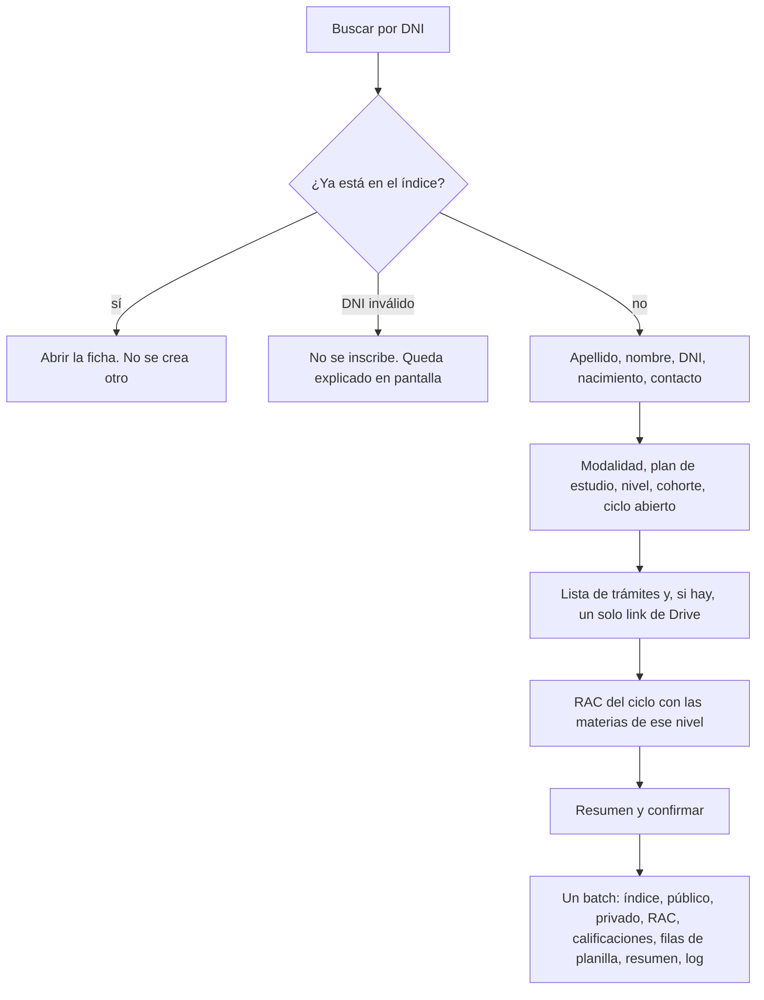
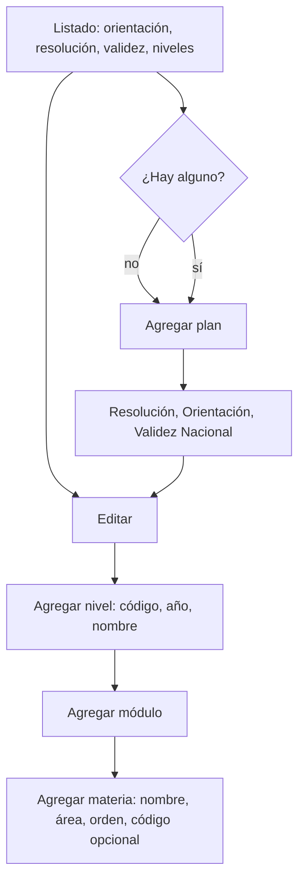

# Plan de rediseño — CEIJA N° 12, sede Las Higueras

Documento de planificación. No implementa pantallas, no cambia reglas y no se despliega.
No toca el proyecto Firebase real (`ceija12resm`). No hay datos personales: los ejemplos son esquemas, no personas.

Fecha del relevamiento de Drive que usa este plan: 22/10/2026. Actualizado el mismo día con las respuestas de Nahuel: planes, asistencia, bajas, nota 6, sin TPI, un solo link de Drive, equivalencias, primera carga, registro oficial y docentes por área. La app vive en https://ceija12resm.web.app. El Libro Matriz en papel y el SGE siguen siendo el registro oficial. Esta herramienta es de trabajo interno de la sede.

## 1. Qué hay que lograr

1. Inscribir estudiantes sin duplicar DNI y sin mezclar el padrón con el legajo privado.
2. Guardar la documentación como **un solo link de Drive por estudiante**, más una lista de qué trámites se entregaron. La app no almacena archivos. El plan Spark no tiene Storage y no hace falta pasarse a Blaze para esto.
3. Administrar el RAC: trayectoria del estudiante, ciclo abierto, cierre y pase al ciclo siguiente.
4. Cargar notas rápido: grilla con teclado, autoguardado, usable en el celular.
5. Una interfaz clara para secretaría y para docentes, de día y en el horario de cursado (martes y miércoles, 20 a 23).

## 2. Diagnóstico

Conviven tres descripciones de la escuela y no dicen lo mismo.

### 2.1. Lo que ya está en el código (modelo nuevo)

El tablero actual (`DashboardLayout`) usa este modelo. Las reglas están en `firestore.rules` y hay pruebas de dominio y de reglas contra el emulador `demo-ceija`.

| Pieza | Estado |
|---|---|
| Roles `admin`, `docente`, `lectura`, `pendiente` (y los viejos `Administrador` / `Profesor`) | Hecho. Nadie se cambia el rol solo. |
| `estudiantes` público + `privado/datos` + `dniIndex` | Hecho. El alta es un solo batch (`crearEstudianteConRac`). |
| `rac/{estudiante}_{año}_{plan}/calificaciones/{espacio}` | Hecho. Cerrar marca `adeuda` y deja la nota de solo lectura. |
| `indices`, `resumenes`, `equivalencias`, `pases`, `logs` | Hechos. El pase provisorio vence a los 60 días. |
| Planilla docente | Existe, pero es lenta de usar: un `<select>` de notas, fecha `mm/aa`, y un botón Guardar por fila. Cada fila pide la nota en una lectura aparte. |
| Documentación | Checkboxes en el legajo privado (pase, DNI, CUS, primaria) más un solo `linkLegajoDrive` y `linkTitulo`. No hay un link por documento. |
| `linkLegajoDrive` está en el documento **público** | Lectura puede ver el link a la carpeta. Si ahí hay escaneos del DNI, sobra. Hay que moverlo al privado. |

Los planes sembrados en `src/domain/planesSede.ts` no coinciden con la página pública ni con el RAC:

- Plan A: seis espacios (Matemática, Lengua, Naturales, Sociales, Inglés, M8), con los módulos numerados M1–M5 de forma arbitraria.
- Plan B y Plan C: otra lista corta (Economía, Derecho, Ciudadanía, Proyecto, Vinculación, Formación profesional), también con un solo M8 compartido.
- La página pública (`src/content/sedePublica.ts`) dice otra cosa: A es 1° (módulos 1, 2, 3 y 8), B es 2° (4, 5 y 8), C es 3° (6, 7, 8 y 9), y en los tres años nombra los mismos cinco rótulos (Matemática, Interpretación y Producción de Textos, Ciencias Naturales, Ciencias Sociales, Área Técnico Profesional). No nombra Inglés.

### 2.2. Lo viejo, que la pantalla ya no usa

Siguen en el repo, desconectados del tablero: `StudentManagement`, `GradesManagement`, `StudyPlanManagement`, `SubjectManagement`, `BulkImportModal`, y las colecciones `students`, `grades`, `subjects`, `studyPlans`, `equivalences`.

`students` junta DNI, contacto y documentación en el mismo documento. Las reglas lo dejan solo para admin. El padrón real de la sede **no está cargado** en el modelo nuevo. El esqueleto `scripts/migracion/migrar.mjs` cuenta un CSV en el emulador y se niega a escribir; si el project id no empieza con `demo-` o si aparece `ceija12resm`, corta.

No hay que revivir esas pantallas. Se borran en la última fase, cuando el padrón nuevo esté verificado.

### 2.3. Lo que muestran las planillas (relevamiento de Drive)

Sin copiar filas de personas:

- **LEGAJOS**: padrón maestro, del orden de 500 filas y 19 columnas con encabezado. Documentación por columna (`SI` / `ADEUDA` / texto), no por link. El único link habitual es el del título (sisfet). La celda vacía no se distingue de "nadie la miró". No hay columna de baja. `ESTADO` solo aparece como título emitido. `CURSADO` es semipresencial o virtual. `PLAN INICIAL` y `PLAN ACTUAL` son textos del estilo `A2026`, `B2022`, a veces la letra sola, a veces dos planes, a veces texto libre.
- **RAC 2026**: una pestaña por Plan A, Plan B, Plan C y VIRTUALES. No es una tabla: es una matriz de bloques por estudiante. En los rótulos, las cuatro pestañas repiten **42 espacios** con código `módulo.orden`:
  - Módulos 1 a 7: `n.1` Lengua, `n.2` Inglés, `n.3` Matemática, `n.4` Cs. Naturales, `n.5` Cs. Sociales (35 espacios).
  - Módulo 8: `8.1` a `8.5` (Ciudadanía, Formación para el trabajo, Derecho del Trabajo, Economía, Formación Profesional).
  - Módulo 9: `9.1` Espacio de orientación, `9.2` Espacio de vinculación.
  - Al final, una sección EQUIVALENCIA de cuatro renglones libres.
- La cantidad de bloques no coincide con la nómina. La fila 2 tiene `#REF!`. VIRTUALES no tiene DNI. Hay más de 15 formatos de fecha, notas en texto (`apro`, `aus`, `10 (diez)`), decimales (6.5, 9.5) y la cadena `PLAN B` / `PLAN C` usada **como nota**, para decir que el espacio ya está acreditado en otro plan.
- Hay un archivo RAC por año, de 2020 a 2026. El de 2026 mezcla fechas viejas: es una trayectoria acumulada, no la lista de lo que se cursa este año.
- **EQUIVALENCIAS HISTORICAS**: fecha, espacio en texto libre, estudiante, DNI, nota, estado (`VERIFICADA` / `FALTA ASENTAR`). El nombre del espacio no usa el código `n.m`.
- Formularios de solicitudes y de inscripción a exámenes: quedan en Forms. Este plan no los reemplaza.
- Problemas de calidad que la importación tiene que dejar en una cola, no adivinar: DNI duplicados, DNI vacíos, DNI no numéricos, edad calculada mal (no se importa la edad), códigos de plan ilegibles, cruce de VIRTUALES solo por nombre.

### 2.4. Qué significan A, B y C

Nahuel lo cerró: en esta modalidad, A, B y C son la forma en que se arma el cursado. **Plan A es 1° año, Plan B es 2° y Plan C es 3°.** No son cohortes ni turnos.

Eso no autoriza a precargar nada. Las listas de `planesSede.ts`, las de la página pública y los 42 rótulos del RAC 2026 son referencias para quien tipee el plan, no una semilla. La pantalla actual (`PlanesPanel`) tiene un botón que llama a `cargarPlanesSede()` y escribe esos seis espacios por año: en el rediseño ese botón y ese arranque automático desaparecen. La colección de planes empieza vacía.

La celda `PLAN B` o `PLAN C` dentro de una nota del RAC sigue significando "ya acreditado en otro año del plan", no un cambio de currícula. VIRTUALES sigue siendo una duda de modalidad (pregunta 1), no un cuarto año.

## 3. Decisiones recomendadas

1. Evolucionar el modelo nuevo. No crear colecciones paralelas `alumnos` / `calificaciones` sueltas: se perderían el legajo privado, el `dniIndex` y las reglas ya probadas.
2. La currícula es configurable por el admin y **no se siembra**. El menú se llama Planes de Estudio. Un plan de estudio tiene Resolución, Orientación y Validez Nacional; adentro, quien administra carga los niveles (A = 1°, B = 2°, C = 3°, u otro código si más adelante hace falta), y en cada nivel los módulos y las materias.
3. Separar tres cosas que hoy están mezcladas en la palabra "RAC":
   - **Plan de estudio**: lo que el admin cargó (niveles, módulos, materias).
   - **Ciclo**: las materias de ese nivel, este año, que el docente edita.
   - **Acreditación**: la materia aprobada, permanente. Una por estudiante y materia. No se borra con la baja ni con el cierre.
4. La planilla del docente lee y escribe filas chicas, una por estudiante. No un arreglo gigante y no una lectura por nota. Quien está de baja no tiene fila.
5. Los archivos no entran a Firebase. Solo URLs de una lista blanca, en el legajo privado.
6. No hay asistencia. Quedó fuera de alcance.
7. Seguir en Spark. Blaze no se justifica con el uso de la sede (sección 8).
8. Sistema de componentes en el repo (sección 7). No un skill genérico de "hacerlo lindo".
9. La importación real la corre Nahuel, en su computadora, cuando las fases anteriores estén aceptadas. Un agente no despliega ni escribe en `ceija12resm`.
10. El Libro Matriz y el SGE son el registro oficial. La app no emite títulos ni reemplaza Gestión Estudiantes: solo registra el estado de carga (`GESTION E`) como dato de secretaría.
11. La nota de aprobación es 6. No hay TPI.
12. Hay pocos docentes, uno por área. Hoy: Matemática, Naturales, Sociales, Inglés, Lengua y ATP (módulos 8 y 9). La asignación es por área, no por materia suelta de un año.

## 4. Modelo de datos

Identificadores opacos (`estudiantes/{id}` autogenerado). El DNI no es el id del estudiante: va solo al índice y al privado. Así un DNI mal cargado se corrige sin mudarlo de documento.

### 4.1. Planes de Estudio

No hay catálogo global precargado. No se escribe `PLANES_SEDE` al abrir la app ni desde un botón. Arte y Cultura, Deportes, los 42 rótulos del RAC y los seis espacios de `planesSede.ts` no entran solos: si existen en la sede, el admin los tipea.

`planesEstudio/{planEstudioId}`:

| Campo | Uso |
|---|---|
| `orientacion` | Obligatoria. Es el título de la fila en el listado. |
| `resolucion` | Obligatoria. Texto que carga el admin (número y año, o el texto que use la sede). |
| `validezNacional` | Obligatoria. Texto libre; la app no valida un formato de resolución nacional. |
| `activo` | Si está en false, no se ofrecen para un alta nueva. Los RAC ya abiertos siguen leyéndose. |
| `creadoPor`, `fechaCreacion` | uid e ISO. |

Nada más en el alta. El nombre no se pide aparte: en la lista se ve la orientación y la resolución.

`planesEstudio/{planEstudioId}/niveles/{nivelId}`:

| Campo | Uso |
|---|---|
| `codigo` | El que escriba el admin. En esta modalidad, A, B y C. No es un enum cerrado: otro plan puede usar otro código. |
| `anioCurso` | Entero. A = 1, B = 2, C = 3. Lo carga quien crea el nivel; la app no inserta los tres sola. |
| `nombre` | Por ejemplo "1° año". |
| `orden` | Para pasar de un nivel al siguiente. |

`planesEstudio/{planEstudioId}/niveles/{nivelId}/modulos/{moduloId}`: `nombre`, `orden`.

`.../modulos/{moduloId}/materias/{materiaId}`:

| Campo | Uso |
|---|---|
| `nombre` | El que se imprime y el que ve el docente. |
| `orden` | Orden dentro del módulo. |
| `area` | Obligatoria. La elige el admin. La lista de la sede, hoy, es Matemática, Naturales, Sociales, Inglés, Lengua y ATP. ATP es el área de los módulos 8 y 9, no un módulo precargado. Si más adelante hay otra área, se escribe: no queda trabada en esas seis. |
| `codigo` | Opcional. Si el admin escribe `1.3`, la importación puede cruzar con el rótulo del RAC. Vacío si no lo necesitan. |
| `comparteEntreNiveles` | Booleano, default false. Si está en true, una nota aprobada se copia a los otros RAC abiertos del mismo estudiante que tengan una materia con el mismo `codigo` y este flag. No reemplaza al docente de ATP: ese docente cubre el área, y cada materia se califica en su nivel salvo que este casillero esté marcado. |
| `activo` | Default true. En false no entra en los RAC nuevos. |
| `enUso` | Pasa a true con la primera calificación. A partir de ahí la materia no se borra. |

El id de la materia es opaco y no cambia aunque le corrijan el nombre. La calificación y la acreditación apuntan a ese id. El nombre se copia en la nota al crear el RAC, para que una edición posterior no reescriba la historia.

Borrar un módulo o un nivel solo si ninguna materia hija tiene `enUso`. Si ya hay notas, se desactiva. La regla prohíbe el delete cuando `enUso` es true. No hace falta un contador en otro documento.

Un RAC se puede abrir solo si el nivel tiene al menos una materia activa. Un plan recién creado, sin niveles, sirve para guardarlo y seguir editándolo; no sirve para inscribir.

### 4.2. Estudiante

`estudiantes/{id}` — lo pueden leer admin y lectura. Sin DNI completo, sin contacto, sin URLs.

| Campo | Notas |
|---|---|
| `apellido`, `nombre` | Texto limpio (sin tabs, espacios simples). No se guarda la edad. |
| `dniEnmascarado` | Como ahora (`**.***.482` es la forma, no un dato real). |
| `estado` | `activo`, `baja`, `egresado`, `pase`. La baja está definida en 4.2.1. |
| `fechaBaja` | ISO `aaaa-mm-dd`, o vacío si no está de baja. La ve también lectura, junto con el estado. Sin motivo. |
| `modalidad` | `semipresencial` o `virtual`. La pestaña VIRTUALES del RAC 2026 no se mapea sola: sigue abierta la pregunta 1. |
| `planEstudioId`, `nivelActualId` | El plan de estudio y el nivel (A, B o C) en el que está hoy. |
| `cohorteAnio` | El año de `B2026`, no la letra. |
| `gestionSge` | `cargado`, `no_cargado`, `pase_solicitado`, `pase_invalido`. Es el estado en Gestión Estudiantes, no el estado académico. |
| `documentacionResumen` | `completa`, `incompleta`, `sin_revisar`. Sin links. Para que lectura vea el semáforo. |
| `sede` | Las Higueras. |
| `condicionIngreso` | `Reg`, `Prev`, `Equiv`, `Lib`. |
| `creadoPor`, `fechaCreacion` | Igual que ahora. |

Sale de acá `linkLegajoDrive`. La carpeta del legajo puede tener escaneos.

`estudiantes/{id}/privado/datos` — solo admin:

`dni`, `dniNormalizado`, `cuil`, `email`, `telefono`, `fechaNacimiento` (ISO `aaaa-mm-dd` o vacío), `observaciones`, `linkDocumentacion`, `checklist`, `detallePrimaria`.

No se guarda `edad`. Doce edades en 126 en la planilla son una fórmula sobre una fecha vacía: se calcula en pantalla si hace falta y hay fecha.

`dniIndex/{dni}` — solo dígitos, 7 u 8. Crear si no existe. No se actualiza. Corregir un DNI es una operación de admin: crear la clave nueva y borrar la vieja, las dos en reglas, con log que guarda el DNI enmascarado y no el completo. Hoy la regla prohíbe update y delete: hay que abrir solo el delete de admin para este caso, no un update libre.

Quien no tiene DNI válido (vacío, "sin DNI", número con texto) **no entra** al índice ni a la planilla. Queda en `revisiones/{id}` (sección 4.8) hasta que secretaría lo resuelva.

#### 4.2.1. Baja

La marca la solo el admin, desde la ficha. Docente y lectura no la cambian.

| Dónde | Qué se guarda |
|---|---|
| `estudiantes/{id}.estado` | `baja` |
| `estudiantes/{id}.fechaBaja` | El día que carga el admin. Default: hoy. |
| `estudiantes/{id}/bajas/{bajaId}` | Solo admin. `fecha`, `motivo` (texto corto, obligatorio), `uid`, `fechaReactivacion` vacía hasta que vuelva. No se borra. |

Efecto, en el mismo batch:

- Se borra la fila de ese estudiante en cada `indices/.../filas/{estudianteId}` de los RAC abiertos. Por eso desaparece de la planilla del docente. No queda una fila oculta.
- No se borra ninguna `calificaciones` ni ninguna `acreditaciones`.
- Cada materia de un RAC abierto que ya esté aprobada (nota ≥ 6, equivalencia, u otro plan) y todavía no tenga acreditación, se copia a `acreditaciones` en ese mismo batch. Aprobar y darse de baja el mismo día no pierde la materia.
- Lo que sigue pendiente queda en el RAC, fuera de la planilla, para consulta de admin y lectura.
- El resumen del padrón actualiza el estado. El directorio sigue encontrando a la persona, con la marca Baja. El filtro de secretaría arranca en Activos.
- El log anota la baja con apellido, nombre y DNI enmascarado. El motivo no va al log.

Reactivación, también solo admin, con confirmación:

- `estado` vuelve a `activo`, `fechaBaja` queda vacía, y el documento de `bajas/{bajaId}` recibe `fechaReactivacion` y el uid. El episodio no se pisa ni se borra.
- Se vuelven a crear filas de planilla solo para las materias del RAC abierto que **no** tienen acreditación. Una materia aprobada no vuelve a la grilla del docente: queda acreditada para siempre y no se recursa.
- Los RAC cerrados no se tocan.

La regla acompaña al cliente: el docente no puede crear una fila de índice si `get` del estudiante dice `estado == 'baja'`. Nadie puede borrar calificaciones ni acreditaciones. Una acreditación ya creada no acepta update (sección 4.5).

El color rojo del RAC de Drive no se puede leer. Esas bajas viejas no entran solas con la importación: secretaría las marca a mano, si las recuerda, después de cargar el padrón. A partir de la app, la baja es este campo.

### 4.3. Documentación: un link y una lista

No hay una URL por trámite y no hay subcolección `documentos`. Nahuel pidió un solo link de Drive por estudiante, para toda la documentación.

En `estudiantes/{id}/privado/datos`, junto con el DNI y el contacto:

| Campo | Uso |
|---|---|
| `linkDocumentacion` | Un solo URL, o vacío. La carpeta del legajo. Host `drive.google.com` o `docs.google.com`. |
| `checklist` | Mapa sin URLs. Claves: `fotocopiaDni`, `certificadoPrimaria`, `cus`, `paseProvisorio`, `paseDefinitivo`, `titulo`. Valor: `presentado`, `adeuda`, `no_corresponde` o `sin_revisar`. |
| `detallePrimaria` | Texto corto opcional: original, constancia, etc. La columna de LEGAJOS es más rica que un sí o un no. |

No se guarda `linkTitulo`. El título digital de sisfet no es una segunda URL en Firebase: si en la planilla aparece, la importación marca `titulo` como presentado y manda esa URL a la cola, para que secretaría la deje dentro de la carpeta de Drive. "Digital en Drive" sin URL deja el pase en `presentado`, el link vacío, y una fila en la cola.

La regla rechaza otro host, rechaza `http`, rechaza un segundo campo de URL y rechaza cualquier string que parezca una ruta de Storage. Celda vacía de la planilla → `sin_revisar`, no `adeuda`. `ADEUDA` → `adeuda`. `SI` o una X → `presentado`. No se inventa un archivo.

El semáforo público (`documentacionResumen`) se recalcula en el mismo batch, sin el link: `completa` si cada ítem está `presentado` o `no_corresponde`; `incompleta` si alguno `adeuda`; `sin_revisar` si todavía hay ítems sin mirar y ninguno adeuda. Lectura ve ese semáforo. El link y la lista ítem por ítem quedan en el privado, solo admin.

La equivalencia no es un documento escaneado. Es un acto (sección 4.6). El número `nnn/aaaa` vive ahí.

### 4.4. Ciclo y RAC editable

`ciclos/{anio}`: `abierto` o `cerrado`, como ahora.

`rac/{estudianteId}_{anio}_{nivelId}`: un RAC por estudiante, año lectivo y nivel. Guarda también `planEstudioId`. Campos actuales (`estado`, apellido, nombre, `resumen`) más `modalidad`.

`rac/{racId}/calificaciones/{materiaId}`: **solo las materias activas de ese nivel**, no una fila vacía por cada materia del plan de estudio completo.

| Campo | Notas |
|---|---|
| `materiaId` | Igual al id del documento. Apunta a la materia que cargó el admin. |
| `nombre`, `modulo`, `orden`, `codigo`, `area` | Copiados de la materia al crear el RAC, para imprimir y para la regla del docente aunque después le cambien el nombre. |
| `notaFinal` | `null` o número de 1 a 10 de a medio punto |
| `notaLetras` | Derivada, como ahora |
| `fecha` | ISO `aaaa-mm-dd`, o vacía. Se deja de usar `mm/aa` como único formato: el RAC histórico tiene día, y el Libro también. En la impresión se puede mostrar `dd/mm/aa` |
| `condicion` | `Reg`, `Prev`, `Equiv`, `Lib`, `Aus`, `OtroPlan` |
| `nivelAcreditadoId` | Solo si `condicion` es `OtroPlan` (la celda decía `PLAN B`, o sea otro año). |
| `estado` | `pendiente`, `aprobado`, `adeuda` |
| `docenteUid`, `actaNro`, `compartidoM8`, `m8RacIds` | `compartidoM8` solo si la materia tiene `comparteEntreNiveles`. |
| `actualizadoEn` | Para el autoguardado y para ver quién pisó a quién |

No hay campo TPI. El que existe hoy en el código (`APROBADO` / `REVISAR`) no se muestra, no se escribe y no se migra. Una nota de 6 o más deja `aprobado` por sí sola. Menos de 6 queda `pendiente` hasta el cierre del RAC, y ahí pasa a `adeuda`.

`Aus` no lleva número y no aprueba. `OtroPlan` no se edita en la planilla del docente: lo carga admin o la importación. `Equiv` llega desde el flujo de equivalencias (4.6), no desde el teclado de la grilla.

Si al armar el RAC ya existe una acreditación de esa materia, la fila nace `Equiv` / `aprobado` y no entra a la planilla del docente. No se vuelve a cursar.

Al aprobar, el mismo batch del cliente copia la acreditación (4.5). Las reglas no confían en el cliente: la acreditación solo entra si un `get` de la calificación muestra la misma nota, el mismo docente y el RAC abierto (sección 9).

### 4.5. Acreditación permanente

`acreditaciones/{estudianteId}_{materiaId}` — una por persona y materia. Es el registro que sobrevive a la baja, al cierre del RAC y al cambio de nivel.

`notaFinal`, `fecha`, `condicion`, `planEstudioId`, `nivelId`, `materiaId`, `nombre` copiado, `anio`, `racId` de origen, `docenteUid`, `equivalenciaId` si aplica.

Se crea cuando la materia queda aprobada (nota de aprobación, equivalencia, u otro nivel) y también en el batch de la baja para lo que ya estuviera aprobado. A partir de ese create:

- `allow update, delete: if false` para todo el mundo, admin incluido.
- La nota, la fecha y la condición no se reescriben. Una corrección posterior es otro documento, `acreditaciones/{id}/rectificaciones/{rectId}`, solo admin, que cita el motivo y la nota correcta. El original queda.
- Volver a cursar esa materia no está previsto: la reactivación no la pone en la planilla.

Si el mismo par estudiante + materia aparece dos veces en la importación (RAC 2024 y RAC 2026), gana la acreditación ya guardada y la otra va a la cola de revisión. No se pisa en silencio. El RAC 2026 se importa primero justamente porque ya es la acumulación.

La pantalla de trayectoria arma las filas en memoria con las materias que el admin cargó en ese plan de estudio (todos los niveles), más la acreditación y la fila del ciclo abierto. Lo que no tiene documento se muestra como "no cursada" o como "pendiente" según la materia pertenezca o no al nivel actual. No se guardan casilleros vacíos: alcanza con las materias de verdad, y un cierre no escribe de más (sección 8).

### 4.6. Equivalencias y pases

La equivalencia no se carga en la inscripción. Primero hay que determinarla. El admin la crea cuando corresponde, en cualquier momento del año: el aviso de "antes de julio" deja de ser una traba.

`equivalencias/{id}`:

| Campo | Quién lo escribe |
|---|---|
| `estudianteId`, `materiaId`, `area`, `nombreMateria` | Admin, al crear. `area` se copia de la materia para la regla del docente. |
| `numero`, `origen` | Admin. El número, si está, tiene forma `nnn/aaaa`. Puede ir vacío. |
| `nota`, `fecha` | Vacías en el alta. Las carga después el docente de esa área, o el admin. Nota de 6 a 10, de a medio punto, y fecha ISO, las dos juntas. |
| `estado` | `pendiente` sin nota. `asentada` cuando hay nota y fecha. |
| `creadoPor`, `cargadoPor` | uid de quien creó y de quien cargó la nota. |

El alta del admin puede incluir nota y fecha si ya las tiene, o ninguna de las dos. Una nota suelta sin fecha, o una fecha sin nota, se rechaza. Una nota menor a 6 también.

Cuando la nota queda cargada, el cliente hace un segundo paso (el `get` de las reglas no ve los otros writes del mismo batch): actualiza la calificación del RAC abierto, si esa materia está, a `Equiv` / `aprobado`, y crea la acreditación. Si no hay RAC abierto para esa materia, igual se crea la acreditación: la materia aprobada no depende de que el estudiante esté cursando ese nivel ahora.

Después de `asentada`, nadie modifica la nota ni la fecha de la equivalencia. El docente no puede cambiar de materia, de estudiante ni borrar. El admin puede borrar solo mientras sigue `pendiente`.

Los nombres históricos ("MATEMATICA PLAN A", "AREA TECNICO PROFESIONAL 2") no se adivinan. Una tabla de alias, sin personas, propone la materia cuyo `codigo` coincida; lo que no matchea queda en la cola. No se da de alta la materia desde el importador. Una fila histórica con nota se importa ya `asentada` y genera acreditación. Una fila sin nota queda `pendiente` para el docente del área.

`pases/{id}` se mantiene: ingreso o egreso, provisorio, definitivo, vencimiento a 60 días, alerta a 15 días (`src/domain/alertas.ts`). Sigue siendo cálculo en el cliente, sin función programada. El formulario de solicitudes de Drive no se lee por API: secretaría carga el pase a mano, como ahora.

### 4.7. Planilla del docente (índice que sí se puede editar)

Hoy `indices/{año}_{plan}_{espacio}` guarda un arreglo `filas` y después la pantalla pide cada nota. Dos problemas: una lectura en cascada por estudiante, y `arrayUnion` no actualiza una fila (un cambio de apellido duplica el elemento).

Reemplazar el arreglo por subdocumentos:

`indices/{anio}_{nivelId}_{materiaId}/filas/{estudianteId}`

Cada fila trae, para que la regla no tenga que hacer `get` del padre en un listado: `planEstudioId`, `nivelId`, `materiaId`, `area`, `anio`, `racId`, `estudianteId`, `apellido`, `nombre`, `dniEnmascarado`, `notaFinal`, `fecha`, `condicion`, `estado`, `racAbierto`. Sin TPI.

No existe la fila si el estudiante está de baja. La consulta del docente no tiene que filtrar bajas a ojo: el documento no está. Si alguien igual intenta crearla, la regla hace `get` del estudiante y rechaza `estado == 'baja'`.

Abrir la planilla es **una consulta** filtrada por área, materia y año (las reglas de listado solo pueden mirar `resource.data`, no otro documento). Guardar es un batch de dos documentos: la calificación (fuente) y esta fila (copia para la grilla). Si la copia falla, la fuente quedó bien y la próxima apertura puede reconstruir; se muestra el error igual.

Tamaño: una comisión es del orden de 20 a 50 filas. Entra holgado en Spark. El resumen anual (`resumenes/estudiantes_{anio}`, un documento con el padrón) también entra: 500 ítems compactos están muy por debajo de 1 MB. Si algún día se acerca, se parte por inicial. No ahora.

### 4.8. Revisión de importación y logs

`revisiones/{id}` — solo admin. No es el padrón: es la cola de lo que no se pudo cargar solo (DNI duplicado, fecha ilegible, nota en texto, VIRTUALES sin DNI unívoco, dos notas para el mismo código). Guarda el motivo, el archivo de origen (`legajos`, `rac-2026`, `equivalencias`), la referencia de fila o bloque, y el DNI enmascarado si había uno válido. No guarda el DNI completo ni el teléfono en un campo que lectura pueda ver. El detalle fino queda en el CSV local de Nahuel, que no se commitea (los `.xlsx` y `.csv` ya están en el gitignore).

`logs/{id}`: crear, nunca editar. `uid` = usuario autenticado. El diff no lleva DNI completo, CUIL, teléfono, mail ni URL de documentos.

### 4.9. Qué no se modela

- **Asistencia.** Nahuel lo sacó del alcance. No hay colección, ni columna en la planilla, ni regla. Las planillas de Drive tampoco la traen.
- **TPI.** No se usa. No hay campo, ni columna, ni valor `APROBADO` / `REVISAR` en las notas nuevas.
- **Una URL por tipo de documento.** Hay un solo link de Drive.
- Inscripción a exámenes (el Form sigue).
- Horarios de tutoría.
- Archivos adjuntos.
- Edad persistida.
- Una semilla de planes, niveles, módulos o materias.
- Una colección `rac` "vista generada" que reemplace a los documentos. La trayectoria se arma al leer; el ciclo y la acreditación son los datos.

## 5. Roles y permisos

Se mantienen los cuatro roles. Los valores viejos siguen andando hasta que se regrabe cada usuario.

| Acción | admin | docente | lectura | pendiente |
|---|---|---|---|---|
| Ver padrón (sin DNI completo ni links) | sí | no | sí | no |
| Ver y editar privado y documentos | sí | no | no | no |
| Ver semáforo de documentación | sí | no | sí | no |
| Ver RAC y trayectoria | sí | las materias de sus áreas, en el ciclo que abre | sí, sin el link de Drive | no |
| Cargar notas del ciclo abierto, en las materias de sus áreas, si el estudiante no está de baja | sí | sí | no | no |
| Cerrar o reabrir RAC | sí | no | no | no |
| Dar de baja y reactivar | sí | no | no. Ve el estado y la fecha, no el motivo | no |
| Planes de Estudio (alta, niveles, módulos, materias) | sí | no | no | no |
| Crear equivalencia, sin nota ni fecha | sí | no | lee | no |
| Cargar nota y fecha de una equivalencia de su área | sí | sí, solo si está `pendiente` | no | no |
| Pases | escribe | no | lee | no |
| Asignar roles y áreas | sí, y no el propio rol | no | no | no |
| Exportar con columnas sensibles | sí, con confirmación | no | no | no |
| Logs | lee | no | no | no |

El docente no necesita el padrón: entra a "Mis planillas". Eso ya está bien encaminado y no se abre.

Asignación en `docentes/{uid}.areas`: un mapa de áreas en true. Las claves estables son `matematica`, `naturales`, `sociales`, `ingles`, `lengua` y `atp`. Un docente de Matemática ve todas las materias con esa área, en todos los niveles y en el ciclo que elija. El de ATP ve las materias marcadas como ATP, que en esta sede son las de los módulos 8 y 9 una vez que el admin las cargue con esa área. No hay una clave `plan|materia|año` ni el flag `ensenaM8`. Después de cargar los planes a mano, cada docente se vuelve a guardar en Usuarios: las claves viejas no sirven.

Nadie se autodesigna rol, `disabled` ni `activo`. El autoregistro sigue creando `pendiente`.

## 6. Pantallas y flujos

Hay que sumar un router (hoy el tablero es un `useState`). Hace falta para la ficha, el botón atrás y para que secretaría comparta "el RAC de este ciclo" sin explicar en qué menú está. Una dependencia de cliente, sin costo en Firebase.

Inicio según el rol, no un menú de once ítems iguales:

- **Admin:** pendientes del día (pases que vencen en 15 días, documentación incompleta, cola de revisión, equivalencias `falta_asentar`) y acceso al padrón.
- **Docente:** las materias de su área en el ciclo abierto, agrupadas por nivel. Si tiene una sola, entra directo a esa planilla.
- **Lectura:** padrón.
- **Pendiente:** la pantalla que ya existe, sin datos.

### 6.1. Inscripción

Criterios del flujo:

- Primero el DNI, después el resto. El duplicado se detecta antes de tipear la ficha.
- Apellido y nombre van separados. Se muestran como "Apellido, Nombre".
- El ciclo tiene que estar abierto, como ahora.
- Si el nivel todavía no tiene materias, se puede guardar la ficha y los documentos, y el RAC espera. La app no inventa materias para destrabar el alta.
- La operación sigue siendo atómica. Con las materias de un solo nivel el batch queda muy por debajo de las 500 operaciones.
- Lectura no ve este formulario.

### 6.2. Ficha

Pestañas: Identidad, Documentos, Trayectoria, Pases, Equivalencias. Si el estado es activo, el admin ve "Dar de baja" (fecha y motivo, con la confirmación de que sale de las planillas y de que las notas quedan). Si está de baja, ve "Reactivar" y el texto de que vuelve solo a las materias que no aprobó. Lectura ve la marca y la fecha, no el motivo y no los botones.

Documentos: la lista de trámites (presentado, adeuda, no corresponde, sin revisar) y un solo campo para pegar el link de la carpeta. Error inmediato si el host no es Drive. No hay botón de subir archivo ni un link por fila. Admin ve el link y la lista. Lectura no entra a esta pestaña: en el padrón ve el semáforo.

Identidad privada (DNI, CUIL, teléfono, mail, nacimiento) solo en la pestaña de admin, no en un renglón suelto como el "ver privado" actual.

### 6.3. RAC

Dos vistas del mismo estudiante:

1. **Este ciclo:** materias activas del nivel, editables si el RAC está abierto, el rol alcanza y el estudiante no está de baja. Cerrar (admin) pasa lo no aprobado a `adeuda`, copia lo aprobado a la acreditación permanente y bloquea. Reabrir exige un motivo que va al log. Generar el ciclo siguiente abre el RAC del nivel que sigue en `orden` dentro del mismo plan de estudio, y arrastra lo no aprobado como `Prev`. Si ese nivel no existe, el botón lo dice y no crea un nivel vacío.
2. **Trayectoria:** las materias que el admin cargó, agrupadas por nivel y por módulo. Nota, fecha, condición, nivel donde se acreditó. Una materia aprobada sigue en esta vista después de la baja. Sirve para imprimir un respaldo de papel. El Libro Matriz no se reemplaza: el pie de la impresión lo dice.

Cerrar el RAC de una persona ya está en la pantalla. Cerrar un nivel entero o toda la sede el mismo día sigue abierto (pregunta 2). Hasta esa respuesta no se arma un cierre masivo: además, un cierre de toda la sede el mismo día puede pasar el cupo de escrituras (sección 8).

### 6.4. Planilla del docente

Una sola tarea: cargar la nota de este espacio.

- Al abrir, el foco cae en la primera nota vacía.
- `1`–`9` carga ese número y baja a la fila siguiente. `0` carga 10.
- `.` o `,` justo después del número lo pasa a medio punto (`6` y después `.` → 6.5).
- `A` marca ausente, sin número.
- `Supr` limpia una nota que todavía está pendiente.
- Flecha abajo o Enter: siguiente. Flecha arriba: anterior.
- Se guarda solo al dejar la fila, o a los 400 ms del último cambio si el docente se queda en la celda. No hay botón Guardar por fila.
- Cada fila muestra el estado: sin cambios, guardando, guardado, error. El error reintenta y no pierde lo tipeado.
- Filtro "solo pendientes". Orden alfabético fijo.
- `Equiv` y `OtroPlan` se ven y no se editan.
- RAC cerrado: la grilla no acepta teclas de nota.
- En pantallas de menos de 720 px no va la tabla ancha: una tarjeta por estudiante, teclado numérico fijo abajo, anterior y siguiente. El docente está en el aula, a veces con el teléfono.
- DNI enmascarado. Sin links. Sin columna de TPI.

Admin puede abrir la misma planilla para un espacio, para corregir. Lectura no escribe.

### 6.5. El resto, sin rediseñarlo de cero

- **Equivalencias:** el admin elige estudiante y materia, y puede dejar nota y fecha vacías. No forma parte del alta del estudiante. En "Mis materias", el docente ve las equivalencias `pendiente` de su área y carga nota y fecha. El admin también puede cargarlas. No hay aviso de julio.
- **Pases:** el alta actual, más el semáforo de vencimiento en el inicio del admin.
- **Usuarios:** el admin marca las áreas de cada docente. La lista muestra Matemática, Naturales, Sociales, Inglés, Lengua y ATP, y cualquier otra área que ya exista en una materia.
- **Exportar:** se mantiene el Excel con confirmación para columnas sensibles. El único link de Drive entra solo en esa exportación de admin.
- **Público:** la landing queda como texto editado a mano. No se genera desde Planes de Estudio. Ya dice que A es 1°, B es 2° y C es 3°, que es lo que confirmó Nahuel. Las materias que lista no se copian a Firestore.

### 6.6. Planes de Estudio

Ítem de menú, solo admin, con ese nombre: **Planes de Estudio**. Reemplaza a "Planes y espacios" y al botón que siembra `planesSede.ts`.

- El listado vacío dice que todavía no hay planes, y el único alta es "Agregar plan". No hay "Cargar planes de la sede" ni un plan de ejemplo.
- El formulario de alta pide solo Resolución, Orientación y Validez Nacional. Los tres son obligatorios. Al guardar, el plan queda sin niveles.
- En el editor se agregan los niveles. El texto de ayuda dice que, en esta modalidad, A es 1° año, B es 2° y C es 3°, y que hay que cargarlos. No se insertan solos ni aunque el admin deje el código vacío.
- Dentro del nivel: módulos, y dentro del módulo: materias. Cada materia pide área. Se puede editar el nombre. Si `enUso` es true, no hay borrar; se puede desactivar para que no entre en los RAC nuevos.
- El checkbox "se comparte entre niveles" arranca destildado. ATP no se siembra solo: el admin crea esas materias y les pone el área ATP.
- Lectura y docente no ven este ítem.

## 7. Interfaz y sistema de diseño

### Cómo está hoy

`src/index.css` tiene unas 2500 líneas hechas a mano. El tema es oscuro, violeta y rosa, con vidrio, sombras grandes y bordes de 24 px. Funciona para el login. Estorba para una planilla: poco contraste para leer números, foco de teclado flojo, densidad baja, y cada pantalla nueva copia clases (`user-mgmt-panel`, `tabla-rac`, `input-field`). Las fuentes salen de Google Fonts; en la red de la escuela eso es una demora evitable.

### Recomendación

**Sí conviene un sistema de componentes. No conviene instalar un skill genérico de diseño web.**

Sistema a instalar en la fase de interfaz, no en este PR:

- **Tailwind CSS v4 + shadcn/ui (primitivos Radix).** Se copia el componente al repo. No es un servicio, no pide Blaze, no manda datos a otro lado. El teclado, el foco y los diálogos ya vienen resueltos, que es lo que la planilla necesita. Se puede tener una grilla densa y un tema claro.
- **Tema de la sede, no el tema actual.** Fondo claro por defecto (secretaría imprime y trabaja de día). Tema oscuro opcional para el cursado de la noche, con los mismos tokens. Tinta y papel, un solo acento. Sin gradientes, sin blobs, sin vidrio.
- **Fuente del sistema** (`ui-sans-serif` y las del equipo). No depender de una fuente remota.
- **Íconos:** se puede seguir con lucide-react, que es lo que shadcn usa.

Un skill de agente, sí, pero **escrito en el repo** cuando empiece la fase de pantallas (una página, no un paquete estético). Tiene que fijar: textos en español rioplatense, tema claro por defecto, atajos de la planilla, lista blanca de links, prohibido inventar datos de estudiantes, prohibido el vidrio violeta. Un skill genérico de "frontend design" empuja landings llamativas: es el reflejo que produjo la UI actual, y en esta app empeora el resultado.

Descartado:

- Skills de Canva (marca, feedback de piezas, redes). Sirven para un afiche, no para la app.
- MUI u otra librería pesada. Se puede, pero la grilla a medida pelea con el tema de la librería, y el paquete es más grande sin darnos el autoguardado.
- Seguir solo con el CSS propio. El login puede quedar un rato; la planilla, la ficha y los formularios no.

## 8. Spark, y cuándo sí sería Blaze

La sede entra en Spark con margen, si se respetan estas cotas:

| Uso | Orden de magnitud | Por qué entra |
|---|---|---|
| Padrón | ~500 estudiantes | Un resumen por año, una lectura |
| Acreditaciones | solo donde hay materia aprobada | Muy por debajo de 1 GiB |
| Abrir una planilla | una consulta de una comisión, sin las bajas | lejos de decenas de miles de lecturas diarias |
| Alta | un batch por persona | por debajo de 500 operaciones y del cupo de escrituras |
| Cierre del RAC de una persona | las materias de ese nivel | entra en un batch. Cerrar toda la sede el mismo día queda para la pregunta 2 y puede pasar el cupo |
| Baja | unas pocas escrituras y un borrado de fila por materia del RAC abierto | entra en un solo batch |

No hacen falta Cloud Functions: la regla y el cliente ya cierran el negocio (nota válida, RAC abierto, rol, DNI único). No hace falta Storage: los archivos quedan en Drive. Los vencimientos de pases se calculan al abrir el inicio. App Check se puede sumar después, en Spark, y no es parte de este rediseño.

Blaze se justificaría solo si más adelante piden alguna de estas cosas: subir los escaneos a Firebase, mandar mails o recordatorios solos, o un cierre único de miles de escrituras que no quepa en el cupo del día. Ninguna está en el pedido. Si el cupo gratuito cambia el día de implementar, se relee antes de la carga real; no se asume que el número de hoy es eterno.

## 9. Impacto en las reglas

Todo se prueba con `npm run test:rules` en el emulador `demo-ceija`. No se despliega desde un agente. El deploy de reglas, cuando toque, lo hace quien administra, junto con el hosting, como dice `AGENTS.md`.

Cambios respecto de `firestore.rules`:

| Ruta | Cambio |
|---|---|
| `estudiantes/{id}` | Sacar cualquier campo URL. Seguir prohibiendo DNI, CUIL, mail, teléfono y nacimiento en el público. Sumar `modalidad`, `gestionSge`, `documentacionResumen`, `planEstudioId`, `nivelActualId`, `fechaBaja`. `estado == 'baja'` solo si `fechaBaja` es `aaaa-mm-dd`. Volver a `activo` solo admin, y en el mismo espíritu: docente no escribe este documento. |
| `privado/datos` | Sigue solo admin. `linkDocumentacion` vacío o host de Drive. El checklist no tiene URLs. No se acepta `linkTitulo` ni una URL por trámite. El link no está en el estudiante público. |
| `estudiantes/{id}/bajas/{bajaId}` | Solo admin lee y crea. Puede completar `fechaReactivacion`. Delete: no. El motivo no está en el documento público. |
| `dniIndex/{dni}` | Sigue create-only para el alta. Delete solo admin, para la corrección, con la clave nueva ya creada. Sigue sin update. |
| `planesEstudio` y subcolecciones `niveles`, `modulos`, `materias` | Admin lee y escribe. Lectura lee, para armar la trayectoria. Docente lee las materias de sus áreas. Create del plan exige `orientacion`, `resolucion` y `validezNacional` no vacíos. La materia exige `area`. Delete de materia, módulo o nivel solo si `enUso` no es true. |
| `planes` y `planes/{id}/espacios` viejos | Dejan de ser el alta de la currícula. Hasta la fase 7 siguen legibles por staff para no romper un RAC de prueba ya escrito; el cliente nuevo no los siembra. |
| `calificaciones` | `materiaId` igual al id del documento. `fecha` vacía o `aaaa-mm-dd` (se va el tope de 7 caracteres). `Aus` y `OtroPlan` en la condición. Sin campo `tpi`: un write que lo traiga se rechaza. Nota ≥ 6 puede quedar `aprobado` sin otro flag. Docente: solo nota, letras, fecha, uid y estado; RAC abierto; estudiante que no esté de baja; `area` asignada. La condición `Equiv` la puede escribir el docente solo en el segundo paso, si `get` de la equivalencia ya asentada coincide en nota, fecha y materia. Admin: también `OtroPlan`. Delete: no. |
| `acreditaciones` | Create: admin, o docente si `get` de la equivalencia asentada o de su calificación coincide en nota, materia y uid. Update y delete: no, ni para admin. Lectura lee. La rectificación es un subdocumento de create, solo admin, que no modifica el padre. |
| `indices/.../filas` | Lectura del listado si `area`, `materiaId` y `anio` del propio documento coinciden con la asignación. Docente actualiza solo los campos de nota y solo si `racAbierto` es true. Create de docente rechazado si el estudiante está de baja. Admin borra la fila al dar de baja y la vuelve a crear al reactivar, solo si no hay acreditación de esa materia. |
| `revisiones` | Solo admin. |
| `equivalencias` | Admin crea con `estudianteId` y `materiaId`. `nota` y `fecha` van las dos vacías, o las dos completas con nota ≥ 6. Docente lee las de su área y, si `estado` es `pendiente`, actualiza solo nota, fecha, letras, `cargadoPor` y `estado`. No cambia materia ni estudiante. Delete solo admin y solo en `pendiente`. |
| `docentes/{uid}` | Admin escribe. El mapa obligatorio pasa a ser `areas`. Dejan de exigirse `ensenaM8` y las claves `plan|espacio|año`. |
| `pases`, `logs`, `users`, `ciclos` | Igual en espíritu. |
| Colecciones viejas | Siguen solo admin hasta la fase 7. Después se niega el acceso en un deploy aparte, cuando ya no haya nada que leer. |

Casos que las pruebas tienen que cubrir, con personas ficticias del emulador:

- Docente no lee el privado ni el link de Drive, ni un índice de otra área.
- Lectura no lee el link ni el motivo de la baja. Sí lee el semáforo.
- Una URL que no sea Drive, y un segundo campo de URL, se rechazan.
- Una calificación con `tpi` se rechaza. Una nota 6 sin TPI queda `aprobado`.
- El admin crea una equivalencia sin nota. El docente de esa área carga nota y fecha. El de otra área no. Después de asentada, los dos rechazan el cambio.
- Docente no escribe una acreditación si la calificación no coincide.
- Una acreditación ya creada rechaza update y delete, también con un usuario admin de prueba.
- RAC cerrado rechaza la nota.
- Estudiante de baja: el docente no le crea fila ni le guarda nota; la calificación que ya estaba sigue legible para admin.
- Nota 6.5 pasa; nota 6.25 no; `Aus` pasa sin número.
- El segundo alta con el mismo DNI falla.
- Un plan de estudio sin resolución, sin orientación o sin validez nacional se rechaza.
- Borrar una materia con `enUso` se rechaza.
- Docente no se promueve a admin.
- `pendiente` no lee estudiantes.

## 10. Migración e importación

Orden. Ningún paso escribe en `ceija12resm` por su cuenta.

### 10.1. Antes de tocar una planilla viva

1. Nahuel saca una copia fechada de LEGAJOS y de RAC 2026, que es la primera carga. Los RAC 2020–2025 se copian cuando llegue esa etapa, no antes. Equivalencias históricas entran con el RAC 2026 si ya están en esa planilla; el archivo viejo de equivalencias se puede sumar en la misma primera carga porque no es otro año de RAC. El script no copia nada solo.
2. Se exporta a CSV en la computadora de quien administra. Esos archivos no entran al git.
3. El admin carga a mano, en el emulador primero, el plan de estudio con sus niveles, módulos y materias. Sin eso el importador no tiene contra qué cruzar una nota. Los rótulos del RAC 2026 le sirven de ayuda en la pantalla, no de archivo para sembrar.

### 10.2. Limpieza, en seco

El script sigue el contrato de `scripts/migracion/migrar.mjs`: `--emulador`, `--dry-run`, host localhost, project id `demo-…`, y aborta si ve `ceija12resm`. En esta fase se le agregan parsers, no una escritura a producción.

| Fuente | Qué hace el parser | Qué manda a la cola |
|---|---|---|
| LEGAJOS | DNI solo dígitos; apellido y nombre separados lo mejor posible; modalidad; gestión; nivel y cohorte si el texto es `A2026` o similar y ese nivel ya existe en el plan cargado; checklist sin inventar URL. Si hay un link de Drive, va al único campo. No crea planes. | DNI vacío, no numérico o duplicado; plan ilegible (`???`, dos planes, letra sola); nivel que el admin todavía no cargó; "digital en Drive" sin URL; URL de sisfet (no se guarda como segundo link) |
| RAC 2026 | Por posición: fila de la nómina = bloque. Ignora `#REF!` y fórmulas. Nota numérica de a medio punto. Fecha a ISO, con los formatos mezclados que se puedan reconocer sin ambigüedad. `PLAN X` → `OtroPlan`. Cruza el rótulo `n.m` con `materia.codigo`. Una nota aprobada genera acreditación. | `apro` sin número, `10 (diez)`, fecha ambigua, bloque que no cae en la nómina, código sin materia cargada, pestaña VIRTUALES |
| VIRTUALES | Cruza por nombre normalizado (sin tildes, espacios simples) contra el padrón ya limpio | Cero coincidencias o más de una |
| EQUIVALENCIAS | Si trae nota y fecha, queda `asentada` y genera acreditación. Si no trae nota, queda `pendiente` para el docente del área. Alias de espacio → `materia.codigo` | Texto de espacio sin materia cargada |
| RAC 2020–2025 | Fuera de la primera carga. Después de que LEGAJOS + RAC 2026 estén aceptados, completa acreditaciones que 2026 no trae. No pisa una nota ya cargada | Mismo código con otra nota |
| `students` / `grades` / `equivalences` | Recién cuando se sepa si en producción hay algo además de pruebas. Si son cuentas de prueba, no se migran: se archivan con las reglas viejas y listo | Cualquier fila cuyo DNI no esté en el padrón limpio |

No se importa la columna EDAD. No se importa el color de la celda: una baja vieja pintada de rojo no se recupera del archivo. Queda activa en la app hasta que secretaría la marque con el flujo de 4.2.1. El importador no da de baja a nadie por su cuenta.

La salida del dry-run son conteos: filas, DNI válidos, duplicados, sin DNI, notas reconocidas, notas a revisar, fechas a revisar, espacios sin código. El detalle con referencias de fila va a un CSV local, gitignoreado, para que secretaría lo resuelva en Drive. El repo no recibe ese CSV.

### 10.3. Ensayo

Gente ficticia, y un plan de estudio ficticio creado con la misma función que va a usar el formulario (`scripts/seed-emulador.ts` ya se niega a correr fuera de localhost). Ese seed de prueba no es el arranque de la app y no llama a `cargarPlanesSede`. Correr el alta, la planilla, una baja, una reactivación, el cierre y una importación dry-run contra el emulador. Criterio: los conteos cierran, la persona de baja no está en la planilla, su acreditación sigue, y las pruebas de reglas pasan.

### 10.4. Carga real

No está en este repositorio como botón. Cuando las fases 1 a 6 estén aceptadas, Nahuel corre la carga desde su computadora, con una cuenta de servicio que no se commitea, en tandas de a lo sumo 400 operaciones, primero un puñado de fichas de prueba que después se borran, después el padrón. El agente no ejecuta ese paso y no despliega reglas ni hosting.

Después de la carga: regrabar a cada docente en Usuarios y marcarle el área (Matemática, Naturales, Sociales, Inglés, Lengua o ATP). Las cuentas de prueba viejas se rotan o se borran en el proyecto real, a mano, como ya pide `AGENTS.md`. La primera tanda de datos es LEGAJOS + RAC 2026. Los RAC anteriores quedan para una tanda posterior.

## 11. Fases y criterios de aceptación

Cada fase es un PR aparte. Este documento es la fase 0 y no incluye código. No se despliega en ninguna.

### Fase 0 — Decisiones

Este plan. Quedan abiertas solo VIRTUALES y el alcance del cierre (sección 12). El resto de las respuestas de Nahuel ya está en las secciones 4, 5, 6, 9 y 10.

Aceptación: el documento describe un alta de plan sin semilla, la baja que saca la fila y conserva la acreditación, nota 6 sin TPI, un solo link de Drive, equivalencias fuera de la inscripción, y docentes por área. No pide asistencia.

### Fase 1 — Modelo de dominio, en pruebas y sin Firebase real

Plan de estudio con resolución, orientación y validez nacional; niveles, módulos y materias con área; baja y reactivación; acreditación que no se borra; checklist y un solo link; equivalencia pendiente sin nota; fechas ISO; condiciones `Aus` y `OtroPlan`; armado de la trayectoria en memoria; parsers puros de nota, fecha y DNI (testeados con strings, sin planillas reales).

Aceptación: `npm run test:domain` pasa. Ningún test usa un DNI o un nombre de una planilla real; los casos son inventados. Un nivel sin materias no arma RAC. Una nota 6 aprueba sin TPI, y el armado de la calificación no tiene campo `tpi`. Dar de baja devuelve las rutas de filas a borrar y las acreditaciones a crear para lo ya aprobado, y no incluye ningún delete de calificaciones. Reactivar no devuelve una fila para una materia que ya tiene acreditación. Una equivalencia sin nota es válida y no acredita. No hay función de dominio que devuelva los planes de `planesSede.ts` como datos iniciales.

### Fase 2 — Reglas en el emulador

Los casos de la sección 9.

Aceptación: `npm run test:rules` pasa contra `demo-ceija`. El script de migración sigue abortando si el project id no es demo.

### Fase 3 — Interfaz base e inscripción

Router, tema claro, ficha, wizard de alta, checklist con un solo link de Drive, y la pantalla Planes de Estudio. Planilla vieja sigue andando hasta la fase 4 para no dejar a los docentes sin nada, si es que ya hay alguien cargando en el modelo nuevo. Si en producción ese modelo sigue vacío, se puede reemplazar directo.

Aceptación, en el emulador o con el proyecto local, con personas ficticias: al entrar, Planes de Estudio está vacío y no aparece un botón de sembrar; se puede crear un plan con los tres campos y después un nivel con un módulo y una materia de un área; el alta no pide equivalencias; el alta duplicada muestra el estudiante existente; un segundo link o un host que no sea Drive no se guarda; lectura no ve el link y sí el semáforo; dar de baja saca a la persona de la planilla y la ficha sigue mostrando la nota; el celular muestra la ficha en una columna. Verificado en el navegador, no solo con una captura.

### Fase 4 — Planilla

Grilla de teclado, autoguardado, filas en subcolección, versión móvil.

Aceptación: con una comisión ficticia de ~30, cargar una columna de notas solo con teclado, sin mouse, y ver cada fila en "guardado". Recargar y encontrar las mismas notas. Una nota 6 queda aprobada y la pantalla no muestra TPI. En ancho de teléfono, cargar una nota con el teclado grande. RAC cerrado no acepta la tecla. El docente de Lengua no abre la planilla de Matemática. Después de una baja, esa fila no está; la nota sigue en el RAC al entrar como admin.

### Fase 5 — Trayectoria, equivalencias, pases, impresión

Aceptación: la trayectoria muestra las materias cargadas en el plan, con huecos explícitos, y sigue mostrando una materia aprobada cuando el estudiante está de baja; el admin crea una equivalencia sin nota y sin fecha, fuera del alta; el docente de esa área carga la nota y la fecha, el de otra área no puede, y al guardar queda `Equiv` con acreditación; reactivar no devuelve esa materia a la planilla; un pase provisorio de más de 60 días aparece vencido en el inicio; la impresión no muestra DNI completo ni el link de Drive, y dice que el Libro Matriz y el SGE son el registro oficial.

### Fase 6 — Importador en seco

Parsers conectados al esqueleto, siempre emulador y dry-run. Cola `revisiones` probada con un CSV ficticio de diez filas, armado a mano, con los defectos de la sección 2.3 (fecha rara, `PLAN B` como nota, DNI duplicado). Ese CSV de prueba no copia filas reales.

Aceptación: el dry-run imprime conteos y no escribe. Sin `--emulador` el proceso sale con error. Un CSV con una fila "a revisar" no produce un estudiante.

### Fase 7 — Carga hecha por la sede, y retiro de lo viejo

Fuera de un agente: copias de Drive, carga por tandas, control de conteos contra el dry-run (cantidad de DNI válidos, no la lista), rotación de cuentas de prueba, deploy de reglas y hosting por quien administra.

Aceptación: el padrón nuevo coincide en conteos con el dry-run aceptado; las pantallas viejas y, en un deploy posterior, el acceso a `students` / `grades` / `subjects` / `studyPlans` / `equivalences` quedan cerrados. Hasta ese deploy las reglas viejas siguen, para no perder un dato por apuro.

## 12. Preguntas para Nahuel

Siguen abiertas estas dos. No traban Planes de Estudio, la ficha ni la planilla de un nivel ya cargado. La pestaña VIRTUALES del RAC 2026 no se importa hasta la primera.

1. **VIRTUALES.** ¿Es el cursado virtual sobre los mismos niveles A, B y C, o es un padrón aparte? En esa pestaña no hay DNI.
2. **Cierre.** ¿Se cierra el RAC de una persona, el de un nivel, o el de toda la sede el mismo día? Mientras tanto, la pantalla cierra de a una persona.

## 13. Qué queda fuera

- Deploy de reglas o de hosting.
- Cualquier lectura o escritura en `ceija12resm` hecha por un agente.
- Subir escaneos, mandar mails, App Check, y reemplazar los Forms de exámenes o de solicitudes.
- Asistencia. Quedó fuera de alcance.
- Sembrar planes, niveles, módulos o materias, incluidos Arte y Cultura, Deportes, los rótulos del RAC y las seis áreas como si ya fueran materias.
- TPI, y una URL por cada trámite.
- Mostrar o commitear datos personales, aunque sea "para probar el import".
- Borrar las colecciones viejas antes de la fase 7.
- Borrar o reescribir una acreditación, incluso al dar de baja.

## 14. Riesgos

| Riesgo | Cómo se contiene |
|---|---|
| Alguien siembra `planesSede.ts` o los 42 rótulos y después hay que mudar las notas | No hay botón de sembrar ni escritura al abrir. La clave de la nota es el id de la materia que cargó el admin. El `codigo` `1.3` es solo un cruce para importar. |
| El docente pisa una acreditación desde la grilla, o la baja la borra | La grilla escribe el ciclo. La acreditación no acepta update ni delete. La baja solo borra filas del índice. `OtroPlan` y `Equiv` no se editan con el teclado. |
| Una materia aprobada vuelve a la planilla al reactivar | La reactivación no crea fila si ya hay acreditación. |
| La copia de la fila de planilla se desfasa | La calificación manda. Hay reconstrucción de la fila y un estado de error visible. |
| El cierre de ciclo se come el cupo de escrituras | No se guardan casilleros vacíos. Hasta la pregunta 2 se cierra de a una persona. |
| La importación "arregla" una nota en texto | Eso va a la cola. No se convierte `apro` en un 6. |
| Un link de DNI queda en un documento que lectura lee | Hay un solo link, en el privado. El público tiene el semáforo, sin URL. |
| El docente carga una equivalencia de otra área, o la crea en el alta | Crear es solo admin, y no está en la inscripción. La nota la escribe quien tiene esa área, con la materia ya elegida. |
| Alguien despliega reglas nuevas antes que la app | Las fases 2 y 3 salen juntas cuando se vaya a producción, en el deploy que haga la sede, no antes. |
